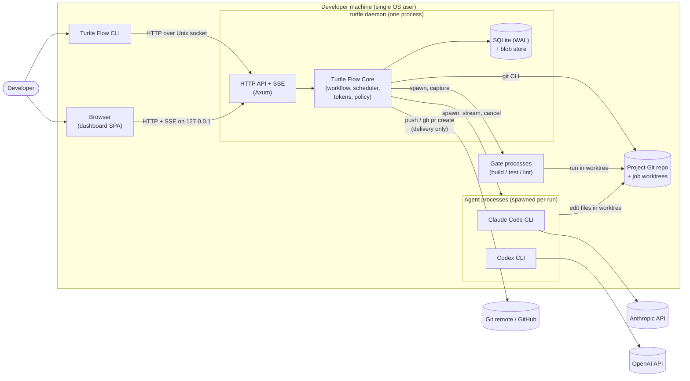
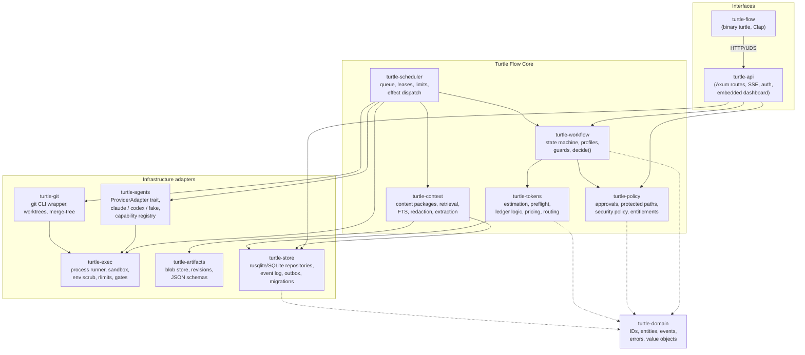
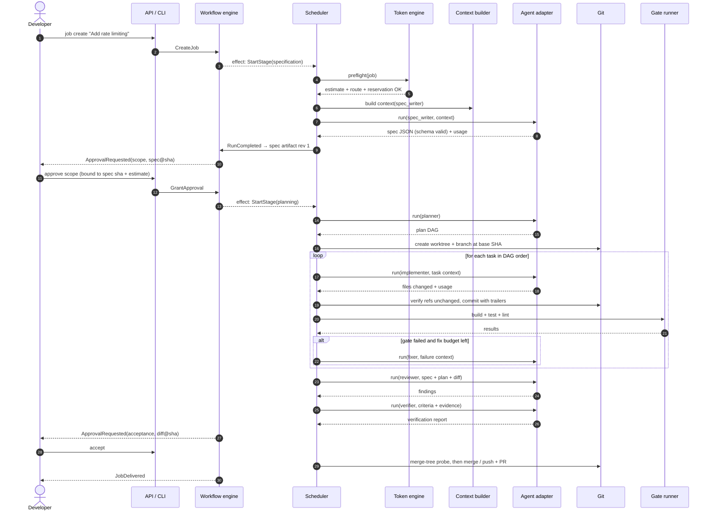

# Architecture — Turtle Flow

| Field | Value |
|---|---|
| Document | ARCHITECTURE.md |
| Status | Proposed baseline (decisions referenced are *Accepted* ADRs) |
| Related | [DOMAIN-MODEL.md](DOMAIN-MODEL.md), [WORKFLOW.md](WORKFLOW.md), [DATA-MODEL.md](DATA-MODEL.md), [adr/](adr/README.md) |

This document describes the overall system: modules, responsibilities, boundaries, runtime model and the key interaction flows. It intentionally avoids restating requirements ([PRD.md](PRD.md)) or decision rationale ([ADRs](adr/README.md)).

---

## 1. Architectural Drivers

| Driver | Source | Architectural consequence |
|---|---|---|
| Deterministic control by Rust | PRD §13, principle 3.1 | All state transitions in a pure state machine; agents produce artifacts only |
| Crash safety & idempotency | NFR-004, NFR-005 | Transactional outbox of *effects*; every side effect has an idempotency key and a completion probe |
| Local-first single binary | NFR-001, NFR-010 | Modular monolith, embedded SQLite, embedded dashboard assets |
| Provider heterogeneity | FR-050 – FR-053 | Adapter trait + capability registry + normalized event stream |
| Token accountability | FR-070 – FR-086 | Ledger with reservations as a first-class subsystem in the run lifecycle |
| Approval integrity | SEC-008, FR-025, FR-032 | Content-hash-bound approvals checked in transition guards |
| Future server mode | PRD §22 | Repository traits, command API, executor abstraction, actor identity on all events |

## 2. System Context

<!-- diagram: 01-system-architecture -->


**Trust note:** the daemon, agent processes and gate processes run as the same OS user in the MVP. The worktree is an isolation boundary for *changes*, not a *security* boundary. See [SECURITY.md §4](SECURITY.md#4-trust-boundaries).

## 3. Process and Runtime Model

**Decision ([ADR-001](adr/ADR-001-local-first-modular-monolith.md)):** a single executable `turtle` with two modes:

| Mode | Invocation | Responsibility |
|---|---|---|
| CLI client | `Turtle Flow <command>` | Parses arguments, talks to the daemon over HTTP on a Unix domain socket, renders output (human or `--json`). Auto-starts the daemon if configured. Contains **no** business logic. |
| Daemon | `turtle daemon` (normally started by `turtle up`) | Owns the database, scheduler, workflow engine, provider adapters, Git operations and HTTP server. |

Rationale for a daemon instead of "CLI does everything": jobs run for tens of minutes to hours, need supervision across terminal sessions, and the dashboard needs a live server. A single long-lived owner also avoids multi-writer SQLite contention and duplicated schedulers.

**Single-instance guarantee:** the daemon acquires an exclusive advisory lock on `~/.turtle/run/daemon.lock` (`flock`) and writes its PID and a random *instance ID* to the `daemon_instance` table. Leases created by an instance carry its ID; a new instance treats leases from a dead instance as expired (see [ADR-017](adr/ADR-017-recovery-idempotency-crash-safety.md)).

### 3.1 Tokio task topology inside the daemon

```text
turtle daemon
├── api_server            Axum on unix socket + 127.0.0.1:<port>
├── command_bus           mpsc<Command>  → single writer task (serializes state changes)
├── effect_dispatcher     polls committed effects (outbox) → spawns effect workers
│   ├── run_supervisor    one per agent run (spawn CLI, stream, enforce limits)
│   ├── gate_supervisor   one per gate execution
│   ├── git_worker        serialized per repository (one Git mutation at a time per repo)
│   └── misc_workers      context packaging, extraction, indexing
├── scheduler             ticks on events + every 2 s; selects eligible work under limits
├── event_broadcaster     tokio::broadcast<EventEnvelope> → SSE + CLI watch streams
├── maintenance           retention, worktree cleanup, WAL checkpoint, backups
└── recovery              runs once at startup before scheduler starts
```

### 3.2 The command → transaction → effect loop

This is the central mechanism for determinism and crash safety ([ADR-004](adr/ADR-004-sqlite-persistence-event-logging.md), [ADR-017](adr/ADR-017-recovery-idempotency-crash-safety.md)).

1. Every state change starts as a **Command** (from a user via API, from the scheduler, or from an effect worker reporting a result).
2. The single **writer task** loads the aggregate (job, run, budget…), asks the pure workflow/policy logic to *decide*, and in **one SQLite transaction** writes: the new state (with optimistic `version` check), one or more **Events** (hash-chained), and zero or more **Effects** (intents to perform side effects, each with an idempotency key).
3. After commit, events are broadcast; the **effect dispatcher** picks up pending effects.
4. An **effect worker** performs the side effect (spawn agent, run gate, create worktree, commit, merge), using the idempotency key to detect prior completion, then submits a result Command (e.g. `RunCompleted`, `GateFinished`), returning to step 1.

```rust
/// Pure decision function: no IO. Lives in turtle-workflow.
pub fn decide(state: &JobAggregate, cmd: &JobCommand, ctx: &DecisionContext)
    -> Result<Decision, TransitionRejected>;

pub struct Decision {
    pub new_state: JobAggregate,     // persisted with version + 1
    pub events: Vec<DomainEvent>,    // appended to event log (hash-chained)
    pub effects: Vec<EffectIntent>,  // appended to outbox, executed after commit
}

pub struct EffectIntent {
    pub id: EffectId,                // ULID
    pub idempotency_key: String,     // e.g. "worktree:create:job_01J..:base_3f2a.."
    pub kind: EffectKind,            // StartAgentRun{..} | RunGate{..} | CreateWorktree{..} | Commit{..} | Merge{..} | ...
    pub not_before: Option<DateTime<Utc>>, // for backoff
    pub max_attempts: u32,
}
```

Why not full event sourcing? State tables remain authoritative for queries and simplicity; the event log is complete enough to audit and to rebuild projections (NFR-017), but we avoid snapshotting, upcasting and replay-on-read complexity in the MVP. Trade-offs in [ADR-004](adr/ADR-004-sqlite-persistence-event-logging.md).

## 4. Component Architecture

<!-- diagram: 02-component-architecture -->


### 4.1 Crate responsibilities and boundaries

**Proposal:** a Cargo workspace with 13 crates. The boundaries are enforced by dependency direction (domain at the bottom, interfaces at the top) and checked in CI with `cargo-deny`'s `bans` or a small dependency-graph test.

| Crate | Responsibility | Depends on | Must NOT depend on |
|---|---|---|---|
| `turtle-domain` | Typed IDs (ULID newtypes), entities, enums (`JobState`, `RunStatus`…), domain events, error taxonomy, value objects (`Sha256`, `TokenCount`, `Money`) | `serde`, `ulid`, `time`/`chrono`, `thiserror` | Any IO crate |
| `turtle-workflow` | Transition table, profiles, guards, `decide()`, step planning, loop counters | domain, policy, tokens (pure parts) | store, agents, git, tokio IO |
| `turtle-policy` | Approval binding & invalidation, protected branch/path rules, security policy resolution & precedence, entitlement checks | domain | store, IO |
| `turtle-tokens` | Complexity scoring, estimators, preflight, reservation math, pricing, router (provider/model selection) | domain, policy | agents (uses registry snapshot passed in) |
| `turtle-context` | Context package assembly, relevance selection, FTS queries, resource text extraction & chunking, secret redaction, token approximation | domain, artifacts, store | agents |
| `turtle-scheduler` | Effect dispatcher, scheduling loop, leases, concurrency limits, run/gate supervisors, executor abstraction (local now, remote later) | domain, workflow, store, agents, git, exec, context, tokens | api |
| `turtle-agents` | `ProviderAdapter` trait, Claude Code & Codex adapters, `FakeAdapter`, capability discovery & registry, output normalization, schema repair loop | domain, exec | store, workflow |
| `turtle-git` | Typed wrapper around Git CLI (sanitized config, hooks disabled), worktree lifecycle, commit with trailers, `merge-tree` conflict probe, recovery probes | domain, exec | store |
| `turtle-exec` | Spawning processes: env allowlist, process groups, timeouts, output caps, rlimits, optional container wrapper | domain, `tokio::process`, `nix` | everything above |
| `turtle-artifacts` | Content-addressed blob store, artifact revision service, JSON Schema validation, Markdown rendering of structured artifacts | domain | store (gets a repository trait) |
| `turtle-store` | rusqlite repositories, migrations, event log hash chain, effect outbox, ledger tables. Persists `turtle-workflow` decisions | domain, policy, workflow (data types only: aggregate, decision, effects, events), tokens (pure estimator types persisted in `estimation_buckets` and the reservation event) | workflow *logic* (`decide` is never called from the store) |
| `turtle-api` | Axum router, auth (token/cookie, Host/Origin checks), SSE, OpenAPI (`utoipa`), static dashboard assets via `rust-embed` | domain, workflow, policy, store | agents, git (only through commands) |
| `turtle-flow` | Binary crate (executable `turtle`): Clap commands; `daemon` subcommand is the composition root wiring all crates; terminal rendering | all | — |

Frontend: `apps/dashboard/` — Astro (static output) with Tailwind CSS v4 and Preact islands, built in CI and embedded into `turtle-api` ([ADR-003](adr/ADR-003-embedded-webserver-dashboard.md)).

### 4.2 Repository traits (persistence boundary)

Domain-facing repository traits allow a PostgreSQL implementation in Phase 2 without touching workflow logic.

```rust
#[async_trait::async_trait]
pub trait UnitOfWork: Send {
    async fn jobs(&mut self) -> &mut dyn JobRepository;
    async fn runs(&mut self) -> &mut dyn RunRepository;
    async fn ledger(&mut self) -> &mut dyn LedgerRepository;
    async fn approvals(&mut self) -> &mut dyn ApprovalRepository;
    async fn append_events(&mut self, events: &[DomainEvent], actor: &Actor) -> Result<(), StoreError>;
    async fn enqueue_effects(&mut self, effects: &[EffectIntent]) -> Result<(), StoreError>;
    async fn commit(self: Box<Self>) -> Result<(), StoreError>;
}

#[async_trait::async_trait]
pub trait JobRepository {
    async fn load(&mut self, id: JobId) -> Result<JobAggregate, StoreError>;
    /// Fails with StoreError::VersionConflict if `expected_version` doesn't match.
    async fn save(&mut self, job: &JobAggregate, expected_version: i64) -> Result<(), StoreError>;
}
```

## 5. Key Flows

### 5.1 Job execution (standard profile, happy path)

<!-- diagram: 04-job-execution-sequence -->


### 5.2 Other flows (documented elsewhere)

| Flow | Location |
|---|---|
| Workflow state machine & approval process | [WORKFLOW.md §3, §6](WORKFLOW.md) |
| Agent routing sequence | [AGENT-PROTOCOL.md §6](AGENT-PROTOCOL.md#6-provider-selection-and-routing-sequence) |
| Token preflight sequence | [TOKEN-INTELLIGENCE.md §6](TOKEN-INTELLIGENCE.md#6-preflight) |
| Git worktree lifecycle | [GIT-STRATEGY.md §3](GIT-STRATEGY.md#3-worktree-lifecycle) |
| Crash recovery | [WORKFLOW.md §10](WORKFLOW.md#10-recovery-behavior) |
| Future server architecture | [ROADMAP.md §5](ROADMAP.md#5-phase-2-turtle-flow-server-architecture) |

## 6. Data and Storage Layout

```text
~/.turtle/                         (TURTLE_HOME, mode 0700)
├── config.toml                     global configuration
├── turtle.db                      SQLite database (WAL mode) + -wal, -shm
├── blobs/sha256/ab/cd/<hash>       content-addressed artifacts, resources, transcripts (0600)
├── worktrees/<project-slug>/<job-key>/   Git worktrees (one per job)
├── run/
│   ├── daemon.lock                 flock for single instance
│   ├── turtle.sock                Unix socket for CLI (0600)
│   └── dashboard.token             hashed dashboard credential reference (secret in keychain)
├── logs/turtle.log.N              JSON-lines logs, rotated
├── backups/turtle-<ts>.db         pre-migration and daily backups (VACUUM INTO)
└── tmp/                            per-run scratch dirs (cleaned on start)
```

Schema: [DATA-MODEL.md](DATA-MODEL.md). Artifacts/resources storage: [ADR-013](adr/ADR-013-resource-artifact-management.md).

## 7. Interfaces

### 7.1 Local HTTP API (versioned `/api/v1`)

The daemon now runs Axum beside the dispatcher, sharing its `SharedStore`, engine, approval service and blob store. It binds `127.0.0.1` only, chooses a random port unless `--api-port` is set, and writes `<TURTLE_HOME>/run/api.port` (0600) until shutdown. `--no-api` disables it. An optional `--tailnet-host <name>` adds exactly that validated lowercase `*.ts.net` hostname to the Host allowlist; when `tailscale` exists, startup detects `Self.DNSName` from `tailscale status --json` unless the flag is supplied. Requests for that Host must use `https://<host>` as Origin and receive `Secure` cookies. The daemon still has no non-loopback listener; Tailscale Serve terminates HTTPS and proxies to its loopback port. `turtle status` reports the local address; `turtle dashboard` launches an interactive, one-use full session. `turtle dashboard --phone` issues a read-only one-time code after checking the daemon and Serve mapping. The CLI still opens SQLite directly. The planned Unix-socket CLI transport and OpenAPI generation are not implemented.

The implemented read endpoints are `/me`, `/overview`, `/projects/{slug}`, `/jobs/{key}` (with `include` for related records), `/approvals/{id}`, `/runs/{id}`, `/runs/{id}/transcript`, `/artifacts/{id}`, `/analytics/usage`, and `/events/stream`, all under `/api/v1`. `/me` reports `{ "readonly": boolean }`. Login codes store `full` or `read_only` scope in migration 0005; redemption copies scope into the bounded in-memory session entry. The request guard blocks every method except GET and HEAD for read-only sessions before routing, including future write routes. SSE uses the hash-chained event `seq` as its ID and resumes from `Last-Event-ID` or `lastEventId`. Writes include `/projects`, `/projects/{slug}/jobs`, `/budgets`, `/approvals/{id}/decisions`, and `/jobs/{key}/commands`. Job command idempotency markers commit in the same transaction as the job transition; project creation checks the canonical Git checkout and job and budget writes use the existing store/engine transactions. The full request and response contract is in [dashboard/API-ASSUMPTIONS.md](dashboard/API-ASSUMPTIONS.md).

Retries and route overrides, resource upload, provider configuration, analytics time series and currency costs, settings editing, license management, and `/openapi.json` are later work. Overview fields with no measured or stored source are `null` or `unavailable`; project health and provider availability are not inferred from an absence of rate-limit records. The live dashboard uses the mock screen structure for available records; it displays the unsupported capabilities above as unknown or read-only. For local source builds, static files are read from `TURTLE_DASHBOARD_DIR` or `dashboard/dist`; a build without assets serves a clear instruction page. Release builds can enable `turtle-flow/embedded-dashboard` after building `dashboard/dist`.

### 7.2 CLI surface (excerpt)

Implemented commands include `up` (with `--agent claude|codex|demo` or an ordered `claude,codex` list, repeated `--role-agent role=provider`, `--codex-model` and `--codex-effort`), `down`, `status` (including active provider limits), `daemon`, `providers list` (provider limit/reset state, latest quota-window percentages with age, and the capability snapshot in effect), `providers refresh` (forced re-discovery that records a new capability snapshot when it changed), project and job commands (`job show` explains rate-limit holds), approvals, token budgets, audit verification, doctor (including a capability snapshot diff after a provider CLI upgrade), and `runs list --job <key>` / `runs transcript <run-id> [--raw]`. `up` and `daemon` accept `--tailnet-host`; `dashboard --phone` prints a read-only QR login after an interactive confirmation when Serve needs configuration. Transcript display is readable event summaries by default; `--raw` prints the stored NDJSON stream, which remains redacted. Differences so far: there is no separate `turtle reject`, `job pause --hard` waits for the current run, and `job cancel` has no `--delete-branch`.

```text
turtle init                         # onboarding wizard
turtle up | down | status
turtle project add <path> [--name] [--profile standard]
turtle project list | show <slug> | archive <slug>
turtle job create -p <slug> "title" [--file job.md] [--profile strict] [--budget 400k]
turtle job list [-p <slug>] [--state active]
turtle job show <key> | watch <key> | events <key>
turtle job pause|resume|cancel <key> [--hard] [--delete-branch]
turtle approvals                    # interactive queue on a TTY
turtle approve <approval-id> [--comment ..]   # shows bound hash, requires confirmation
turtle reject <approval-id> --comment ..
turtle runs list --job <key> | transcript <run-id> [--raw]
turtle budget show [-p <slug>] | set -p <slug> --monthly 20M --hard
turtle providers list | test <provider> | prices edit
turtle resource add -p <slug> <file> [--job <key>] [--trust untrusted]
turtle search -p <slug> "query"
turtle doctor [--project <slug>]
turtle export job <key> --format md|json
turtle audit verify
turtle dashboard                    # opens browser with one-time login code
```

## 8. Cross-Cutting Concerns

| Concern | Approach | Reference |
|---|---|---|
| Error handling | `thiserror` typed errors per crate; `anyhow` only in the binary; errors carry a stable `code` (e.g. `E_GIT_CONFLICT`) used in API responses and UI | [AGENT-PROTOCOL.md §7](AGENT-PROTOCOL.md#7-error-taxonomy-and-handling) |
| Configuration | TOML; layered: built-in defaults → `~/.turtle/config.toml` → repo `.turtle/project.toml` (tighten-only for security) → DB overrides → CLI flags | [turtle-config.toml](examples/turtle-config.toml), [project-config.toml](examples/project-config.toml) |
| Observability | `tracing` with JSON subscriber; spans per job/task/run; events table as audit; metrics derived from DB | [ADR-016](adr/ADR-016-observability-auditability.md) |
| Time & IDs | ULIDs (sortable), UTC timestamps, monotonic clock for timeouts | [DOMAIN-MODEL.md](DOMAIN-MODEL.md) |
| Security | Loopback-only, token auth, sandboxed runs, env scrubbing, hooks disabled, redaction, hash-chained audit | [SECURITY.md](SECURITY.md) |
| Licensing | `Entitlements` service consulted by API and scheduler; all features entitled in MVP | [ADR-014](adr/ADR-014-licensing-architecture.md) |
| Versioning | API `/api/v1`; JSON Schemas for artifacts versioned (`spec.v1.json`); DB `user_version` + migration table | [DATA-MODEL.md §6](DATA-MODEL.md#6-migration-strategy) |

## 9. Technology Choices (summary)

| Concern | Choice | Alternatives considered | ADR |
|---|---|---|---|
| Async runtime | Tokio | async-std (inactive), smol | [ADR-002](adr/ADR-002-rust-technology-stack.md) |
| CLI | Clap (derive) | argh, bpaf | ADR-002 |
| HTTP | Axum + tower-http | Actix-web, Warp, Poem | ADR-002/003 |
| DB | SQLite via rusqlite (WAL, single writer; see ADR-002 amendment) | SQLx, Diesel, SeaORM, embedded KV (redb) | [ADR-004](adr/ADR-004-sqlite-persistence-event-logging.md) |
| Git | Git CLI (writes) + `gix` for fast read-only queries (optional) | git2/libgit2 (worktree & merge-tree gaps, C dependency) | [ADR-009](adr/ADR-009-git-worktree-isolation.md) |
| Live updates | SSE | WebSockets (bidirectional not needed) | ADR-003 |
| Frontend | Astro (static) + Tailwind CSS v4 + Preact islands; Asap Sharp + JetBrains Mono (self-hosted); Fluent icons via `astro-icon` (build time) | Vite + React + TanStack (original choice), TanStack Start, SvelteKit (adapter-static), Leptos/Dioxus (Rust WASM) | ADR-003 (amended) |
| Search | SQLite FTS5 | tantivy, Meilisearch | [ADR-010](adr/ADR-010-project-memory-context-retrieval.md) |
| Serialization | serde, serde_json, toml | — | — |
| JSON Schema | `jsonschema` crate; schemas generated from Rust types with `schemars` | hand-written schemas | [AGENT-PROTOCOL.md](AGENT-PROTOCOL.md) |
| OpenAPI | `utoipa` | aide, hand-written | ADR-003 |
| Crypto | `sha2`, `ed25519-dalek`, `ring`-free where possible | — | ADR-014 |
| Keychain | `keyring` crate | file-based secrets | [SECURITY.md](SECURITY.md) |

## 10. Deployment View (MVP)

- Distribution: GitHub Releases binaries + Homebrew tap + `cargo install` (source). Signed (minisign/cosign) with SBOM.
- Install footprint: one binary (~25–40 MB including embedded dashboard, estimate).
- Runtime prerequisites: Git ≥ 2.38, one provider CLI installed and authenticated.
- Supported OS: macOS 13+, Linux (glibc ≥ 2.31). Windows: WSL2 best-effort (NG7).

## 11. Evolution to Server Mode (preview)

The same crates compose into a `turtle-server` binary with PostgreSQL repositories, OIDC auth middleware, RBAC in `turtle-policy`, and a remote `Executor` that hands agent runs and gates to worker nodes via leases. Details: [ROADMAP.md §5](ROADMAP.md#5-phase-2-turtle-flow-server-architecture) and [ADR-015](adr/ADR-015-future-server-deployment.md).

## 12. Architectural Constraints and Invariants

1. **I-1** No crate except `turtle-store` issues SQL.
2. **I-2** No crate except `turtle-exec` spawns OS processes (`turtle-git` and `turtle-agents` use it).
3. **I-3** `turtle-workflow::decide()` is pure and synchronous; it is property-tested.
4. **I-4** All state changes go through the command bus and single writer; HTTP handlers never write tables directly.
5. **I-5** Every effect has an idempotency key and a completion probe ([ADR-017](adr/ADR-017-recovery-idempotency-crash-safety.md)).
6. **I-6** Agent output is data. It is parsed, validated and evaluated by guards; it never selects transitions.
7. **I-7** Every event records `actor_kind` (`user`, `system`, `agent_run`, `scheduler`) and `actor_id`.
8. **I-8** The user's main working tree is read-only to Turtle Flow.
