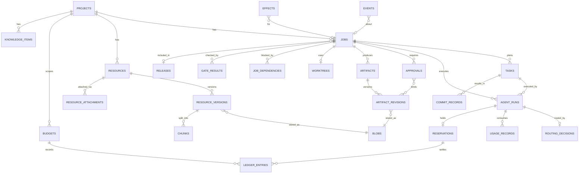

# Data Model — SQLite Schema Proposal

| Field | Value |
|---|---|
| Document | DATA-MODEL.md |
| Status | Proposal (schema evolves via migrations); persistence decision in [ADR-004](adr/ADR-004-sqlite-persistence-event-logging.md) |
| Related | [DOMAIN-MODEL.md](DOMAIN-MODEL.md), [ADR-013](adr/ADR-013-resource-artifact-management.md), [ADR-017](adr/ADR-017-recovery-idempotency-crash-safety.md) |

---

## 1. Conventions

| Convention | Rule |
|---|---|
| Engine | SQLite ≥ 3.45, WAL mode, `foreign_keys=ON`, `busy_timeout=5000`, `synchronous=FULL` (approvals/ledger durability; measured cost acceptable at Turtle Flow write rates — spike S-7) |
| IDs | ULID stored as `TEXT` (26 chars, Crockford base32) — sortable, portable to Postgres; prefixed in API (`job_01J…`) but stored raw |
| Timestamps | `TEXT` RFC 3339 UTC with milliseconds (`2026-10-24T09:14:03.120Z`) |
| Booleans | `INTEGER` 0/1 with `CHECK` |
| Enums | `TEXT` with `CHECK (col IN (...))` |
| JSON | `TEXT` validated with `CHECK (json_valid(col))`; queried with `json_extract` sparingly |
| Hashes | `TEXT` lowercase hex SHA-256 (64 chars) |
| Money | `INTEGER` micro-units (1e-6 of currency) + `currency TEXT` |
| Tokens | `INTEGER` |
| Optimistic concurrency | `version INTEGER NOT NULL` on aggregates (`jobs`, `releases`, `budgets`) |
| Soft delete | Not used; archival via `status` |
| Blobs | Never stored in SQLite; `blobs` table indexes content-addressed files |

Writes go through a **single writer connection**; reads use a pool of read-only connections (`mode=ro`).

## 2. Entity Relationship Diagram

<!-- diagram: 08-database-erd -->


## 3. Schema (DDL excerpts)

> The DDL below is the proposed initial migration (`0001_init.sql`), abridged to the essential columns, constraints and indexes. Column lists marked `-- …` are completed during implementation.

### 3.1 Turtle Flow and projects

```sql
CREATE TABLE daemon_instances (
  instance_id   TEXT PRIMARY KEY,
  pid           INTEGER NOT NULL,
  started_at    TEXT NOT NULL,
  heartbeat_at  TEXT NOT NULL,
  version       TEXT NOT NULL,
  stopped_at    TEXT
);

CREATE TABLE projects (
  id              TEXT PRIMARY KEY,
  slug            TEXT NOT NULL UNIQUE CHECK (slug GLOB '[a-z0-9]*' AND length(slug) BETWEEN 2 AND 40),
  key_prefix      TEXT NOT NULL UNIQUE CHECK (length(key_prefix) BETWEEN 2 AND 6),
  name            TEXT NOT NULL,
  description     TEXT NOT NULL DEFAULT '',
  repo_path       TEXT NOT NULL,
  default_branch  TEXT NOT NULL,
  default_profile TEXT NOT NULL DEFAULT 'standard',
  settings_json   TEXT NOT NULL DEFAULT '{}' CHECK (json_valid(settings_json)),
  status          TEXT NOT NULL DEFAULT 'active' CHECK (status IN ('active','archived')),
  next_job_number INTEGER NOT NULL DEFAULT 1,
  created_at      TEXT NOT NULL,
  updated_at      TEXT NOT NULL
);
CREATE UNIQUE INDEX ux_projects_repo_active ON projects(repo_path) WHERE status = 'active';

CREATE TABLE workflow_profiles (
  id          TEXT PRIMARY KEY,
  project_id  TEXT REFERENCES projects(id),           -- NULL = global
  name        TEXT NOT NULL,
  base        TEXT NOT NULL CHECK (base IN ('fast','standard','strict')),
  definition  TEXT NOT NULL CHECK (json_valid(definition)),
  content_sha TEXT NOT NULL,
  created_at  TEXT NOT NULL,
  UNIQUE (project_id, name, content_sha)
);
```

### 3.2 Jobs, tasks, dependencies

```sql
CREATE TABLE jobs (
  id               TEXT PRIMARY KEY,
  project_id       TEXT NOT NULL REFERENCES projects(id),
  number           INTEGER NOT NULL,
  title            TEXT NOT NULL,
  description      TEXT NOT NULL,
  type             TEXT NOT NULL CHECK (type IN ('feature','bugfix','refactor','docs','chore')),
  priority         TEXT NOT NULL DEFAULT 'normal' CHECK (priority IN ('low','normal','high','urgent')),
  state            TEXT NOT NULL CHECK (state IN ('backlog','discovery','specification','scope_approval',
                     'planning','plan_approval','implementation','build_test','review','verification',
                     'acceptance_approval','delivery','awaiting_release','done','blocked','cancelled','failed')),
  holds_json       TEXT NOT NULL DEFAULT '[]' CHECK (json_valid(holds_json)),
  blocked_json     TEXT CHECK (blocked_json IS NULL OR json_valid(blocked_json)),  -- reason, from_state, allowed_targets
  profile_snapshot TEXT NOT NULL CHECK (json_valid(profile_snapshot)),
  profile_sha      TEXT NOT NULL,
  loop_counters    TEXT NOT NULL DEFAULT '{}' CHECK (json_valid(loop_counters)),
  complexity_class TEXT CHECK (complexity_class IN ('XS','S','M','L','XL')),
  complexity_score INTEGER,
  base_commit      TEXT,
  budget_id        TEXT REFERENCES budgets(id),
  release_required INTEGER NOT NULL DEFAULT 0 CHECK (release_required IN (0,1)),
  reopened_from    TEXT REFERENCES jobs(id),
  version          INTEGER NOT NULL DEFAULT 0,   -- matches JobAggregate::new; incremented by every accepted command
  created_at       TEXT NOT NULL,
  updated_at       TEXT NOT NULL,
  ended_at         TEXT,
  UNIQUE (project_id, number)
);
CREATE INDEX ix_jobs_project_state ON jobs(project_id, state);
CREATE INDEX ix_jobs_active ON jobs(state, priority, created_at)
  WHERE state NOT IN ('done','cancelled','failed');

CREATE TABLE job_dependencies (
  job_id        TEXT NOT NULL REFERENCES jobs(id),
  depends_on_id TEXT NOT NULL REFERENCES jobs(id),
  PRIMARY KEY (job_id, depends_on_id),
  CHECK (job_id <> depends_on_id)
);

CREATE TABLE tasks (
  id               TEXT PRIMARY KEY,
  job_id           TEXT NOT NULL REFERENCES jobs(id),
  plan_revision_id TEXT NOT NULL REFERENCES artifact_revisions(id),
  ordinal          INTEGER NOT NULL,
  title            TEXT NOT NULL,
  instructions     TEXT NOT NULL,
  expected_paths   TEXT NOT NULL DEFAULT '[]' CHECK (json_valid(expected_paths)),
  criteria_refs    TEXT NOT NULL DEFAULT '[]' CHECK (json_valid(criteria_refs)),
  depends_on       TEXT NOT NULL DEFAULT '[]' CHECK (json_valid(depends_on)),
  role             TEXT NOT NULL DEFAULT 'implementer',
  complexity_class TEXT CHECK (complexity_class IN ('XS','S','M','L','XL')),
  estimate_p50     INTEGER, estimate_p90 INTEGER,
  state            TEXT NOT NULL CHECK (state IN ('pending','ready','running','gating','fixing',
                     'succeeded','failed','skipped','superseded')),
  fix_iterations   INTEGER NOT NULL DEFAULT 0,
  commit_sha       TEXT,
  created_at       TEXT NOT NULL, updated_at TEXT NOT NULL,
  UNIQUE (plan_revision_id, ordinal)
);
CREATE INDEX ix_tasks_job_state ON tasks(job_id, state);
```

### 3.3 Agent runs, routing, usage

```sql
CREATE TABLE agent_runs (
  id                  TEXT PRIMARY KEY,
  job_id              TEXT NOT NULL REFERENCES jobs(id),
  task_id             TEXT REFERENCES tasks(id),
  role                TEXT NOT NULL,
  stage               TEXT NOT NULL,
  attempt             INTEGER NOT NULL DEFAULT 1,
  repair_attempt      INTEGER NOT NULL DEFAULT 0,
  provider            TEXT NOT NULL,
  model               TEXT NOT NULL,
  cli_version         TEXT,
  adapter_version     TEXT NOT NULL,
  routing_decision_id TEXT REFERENCES routing_decisions(id),
  context_manifest_rev TEXT REFERENCES artifact_revisions(id),
  reservation_id      TEXT REFERENCES reservations(id),
  status              TEXT NOT NULL CHECK (status IN ('queued','starting','running','succeeded',
                        'failed','cancelled','timed_out','abandoned')),
  error_code          TEXT, error_retryable INTEGER, error_message TEXT,
  provider_session_id TEXT,
  lease_instance_id   TEXT REFERENCES daemon_instances(instance_id),
  lease_expires_at    TEXT,
  pid                 INTEGER, pid_start_time TEXT,
  exit_code           INTEGER,
  output_revision_id  TEXT REFERENCES artifact_revisions(id),
  transcript_blob     TEXT REFERENCES blobs(sha256),
  started_at TEXT, ended_at TEXT, created_at TEXT NOT NULL
);
CREATE INDEX ix_runs_job ON agent_runs(job_id, created_at);
CREATE INDEX ix_runs_live ON agent_runs(status) WHERE status IN ('queued','starting','running');
CREATE INDEX ix_runs_bucket ON agent_runs(role, provider, model, status);

CREATE TABLE routing_decisions (
  id          TEXT PRIMARY KEY,
  job_id      TEXT NOT NULL REFERENCES jobs(id),
  role        TEXT NOT NULL,
  chosen      TEXT NOT NULL,                       -- provider/model
  candidates  TEXT NOT NULL CHECK (json_valid(candidates)),  -- scores, filters, estimates
  reason      TEXT NOT NULL,
  override    INTEGER NOT NULL DEFAULT 0,
  created_at  TEXT NOT NULL
);

CREATE TABLE usage_records (
  id               TEXT PRIMARY KEY,
  run_id           TEXT NOT NULL REFERENCES agent_runs(id),
  project_id       TEXT NOT NULL REFERENCES projects(id),
  job_id           TEXT NOT NULL REFERENCES jobs(id),
  task_id          TEXT REFERENCES tasks(id),
  provider         TEXT NOT NULL,
  model            TEXT NOT NULL,
  input_tokens     INTEGER NOT NULL,
  cached_read      INTEGER, cached_write INTEGER,
  output_tokens    INTEGER NOT NULL,
  reasoning_tokens INTEGER,
  provenance       TEXT NOT NULL CHECK (provenance IN ('reported','estimated','unavailable')),
  estimation_method TEXT,
  cost_reported_micros INTEGER,
  cost_computed_micros INTEGER,
  currency         TEXT,
  billing_mode     TEXT NOT NULL CHECK (billing_mode IN ('api_metered','subscription','enterprise_contract','unknown')),
  price_table_version INTEGER,
  recorded_at      TEXT NOT NULL
);
CREATE INDEX ix_usage_project_time ON usage_records(project_id, recorded_at);
CREATE INDEX ix_usage_provider_model_time ON usage_records(provider, model, recorded_at);
CREATE INDEX ix_usage_job ON usage_records(job_id);
```

### 3.4 Budgets, reservations, ledger, estimation

```sql
CREATE TABLE budgets (
  id            TEXT PRIMARY KEY,
  scope_kind    TEXT NOT NULL CHECK (scope_kind IN ('Turtle Flow','project','job','task')),
  scope_id      TEXT,                               -- NULL for Turtle Flow
  period        TEXT NOT NULL CHECK (period IN ('lifetime','monthly','weekly')),
  period_start  TEXT,
  limit_tokens  INTEGER, limit_cost_micros INTEGER, currency TEXT,
  hard          INTEGER NOT NULL CHECK (hard IN (0,1)),
  settled_tokens  INTEGER NOT NULL DEFAULT 0,       -- cached projection of ledger
  reserved_tokens INTEGER NOT NULL DEFAULT 0,       -- cached projection of ledger
  settled_cost_micros INTEGER NOT NULL DEFAULT 0,
  reserved_cost_micros INTEGER NOT NULL DEFAULT 0,
  warn_thresholds TEXT NOT NULL DEFAULT '[0.5,0.8,1.0]',
  version       INTEGER NOT NULL DEFAULT 1,
  CHECK (limit_tokens IS NOT NULL OR limit_cost_micros IS NOT NULL)
  -- Hard-limit invariant B-1 is enforced in the reservation transaction, not by CHECK:
  -- settlement may legitimately overrun (TOKEN-INTELLIGENCE §4.2), which a CHECK would reject.
);
CREATE UNIQUE INDEX ux_budgets_scope ON budgets(scope_kind, IFNULL(scope_id,''), period, IFNULL(period_start,''));

CREATE TABLE reservations (
  id          TEXT PRIMARY KEY,
  run_id      TEXT NOT NULL UNIQUE REFERENCES agent_runs(id),
  tokens      INTEGER NOT NULL,
  cost_micros INTEGER,
  status      TEXT NOT NULL CHECK (status IN ('open','settled','released')),
  created_at  TEXT NOT NULL, closed_at TEXT
);

CREATE TABLE ledger_entries (
  id             TEXT PRIMARY KEY,
  budget_id      TEXT NOT NULL REFERENCES budgets(id),
  reservation_id TEXT REFERENCES reservations(id),
  kind           TEXT NOT NULL CHECK (kind IN ('reserve','settle','release','adjust','limit_change')),
  tokens_delta_reserved INTEGER NOT NULL DEFAULT 0,
  tokens_delta_settled  INTEGER NOT NULL DEFAULT 0,
  cost_delta_reserved_micros INTEGER NOT NULL DEFAULT 0,
  cost_delta_settled_micros  INTEGER NOT NULL DEFAULT 0,
  reason         TEXT,
  event_seq      INTEGER NOT NULL REFERENCES events(seq),
  created_at     TEXT NOT NULL,
  UNIQUE (budget_id, reservation_id, kind)          -- idempotency: one reserve/settle/release per reservation per budget
);

CREATE TABLE estimation_buckets (
  bucket_key   TEXT PRIMARY KEY,                    -- e.g. "p:<project>|r:implementer|c:M|pv:codex|m:<model>"
  level        INTEGER NOT NULL,                    -- 0 = most specific
  n            INTEGER NOT NULL,
  mean_ln      REAL NOT NULL,
  m2_ln        REAL NOT NULL,
  reservoir    TEXT NOT NULL CHECK (json_valid(reservoir)),
  updated_at   TEXT NOT NULL
);

-- Added by forward migration 0002: idempotent calibration even for unmetered runs.
CREATE TABLE estimation_observations (
  run_id TEXT PRIMARY KEY REFERENCES agent_runs(id),
  observed_at TEXT NOT NULL
);

CREATE TABLE preflight_reports (
  id TEXT PRIMARY KEY, job_id TEXT NOT NULL REFERENCES jobs(id), stage TEXT NOT NULL,
  revision_id TEXT NOT NULL REFERENCES artifact_revisions(id),
  decision TEXT NOT NULL CHECK (decision IN ('allow','require_approval','deny')),
  p10 INTEGER, p50 INTEGER, p90 INTEGER, confidence TEXT, envelope_tokens INTEGER,
  created_at TEXT NOT NULL
);

CREATE TABLE price_tables (
  version INTEGER NOT NULL, provider TEXT NOT NULL, model TEXT NOT NULL,
  input_per_mtok_micros INTEGER, cached_read_per_mtok_micros INTEGER, cached_write_per_mtok_micros INTEGER,
  output_per_mtok_micros INTEGER, reasoning_per_mtok_micros INTEGER, currency TEXT NOT NULL,
  effective_from TEXT NOT NULL, source_note TEXT,
  PRIMARY KEY (version, provider, model)
);
```

### 3.5 Artifacts, blobs, approvals, gates

```sql
CREATE TABLE blobs (
  sha256      TEXT PRIMARY KEY,
  size_bytes  INTEGER NOT NULL,
  media_type  TEXT NOT NULL,
  compression TEXT NOT NULL DEFAULT 'none' CHECK (compression IN ('none','zstd')),
  ref_count   INTEGER NOT NULL DEFAULT 0,
  created_at  TEXT NOT NULL
);

CREATE TABLE artifacts (
  id         TEXT PRIMARY KEY,
  project_id TEXT NOT NULL REFERENCES projects(id),
  job_id     TEXT REFERENCES jobs(id),
  release_id TEXT REFERENCES releases(id),
  kind       TEXT NOT NULL,
  created_at TEXT NOT NULL
);
CREATE INDEX ix_artifacts_job_kind ON artifacts(job_id, kind);

CREATE TABLE artifact_revisions (
  id             TEXT PRIMARY KEY,
  artifact_id    TEXT NOT NULL REFERENCES artifacts(id),
  rev            INTEGER NOT NULL,
  sha256         TEXT NOT NULL REFERENCES blobs(sha256),
  schema_id      TEXT,                              -- e.g. 'spec.v1'
  author_kind    TEXT NOT NULL CHECK (author_kind IN ('agent_run','user','system')),
  author_id      TEXT,
  parent_rev_id  TEXT REFERENCES artifact_revisions(id),
  created_at     TEXT NOT NULL,
  UNIQUE (artifact_id, rev)
);

CREATE TABLE approvals (
  id              TEXT PRIMARY KEY,
  job_id          TEXT REFERENCES jobs(id),
  release_id      TEXT REFERENCES releases(id),
  gate_kind       TEXT NOT NULL CHECK (gate_kind IN ('scope','plan','budget_increase','scope_change',
                    'acceptance','policy_exception','release')),
  binding_json    TEXT NOT NULL CHECK (json_valid(binding_json)),
  subject_hash    TEXT NOT NULL,
  status          TEXT NOT NULL CHECK (status IN ('pending','approved','rejected','changes_requested',
                    'expired','invalidated','superseded')),
  decided_by      TEXT, decided_at TEXT, channel TEXT, comment TEXT,
  auto_rule_id    TEXT,
  expires_at      TEXT,
  invalidated_reason TEXT,
  hmac            TEXT,                             -- HMAC-SHA256 over (id, subject_hash, status, decided_by, decided_at)
  created_at      TEXT NOT NULL,
  CHECK (job_id IS NOT NULL OR release_id IS NOT NULL)
);
CREATE UNIQUE INDEX ux_approvals_one_pending ON approvals(job_id, gate_kind) WHERE status = 'pending';
CREATE INDEX ix_approvals_status ON approvals(status, created_at);

CREATE TABLE approval_bindings (                    -- normalized links for querying
  approval_id TEXT NOT NULL REFERENCES approvals(id),
  revision_id TEXT NOT NULL REFERENCES artifact_revisions(id),
  PRIMARY KEY (approval_id, revision_id)
);

CREATE TABLE gate_results (
  id          TEXT PRIMARY KEY,
  job_id      TEXT NOT NULL REFERENCES jobs(id),
  task_id     TEXT REFERENCES tasks(id),
  gate        TEXT NOT NULL,
  outcome     TEXT NOT NULL CHECK (outcome IN ('passed','failed','error','skipped')),
  command     TEXT,
  exit_code   INTEGER,
  duration_ms INTEGER,
  head_commit TEXT NOT NULL,
  tree_hash   TEXT NOT NULL,
  summary_json TEXT CHECK (summary_json IS NULL OR json_valid(summary_json)),
  output_blob TEXT REFERENCES blobs(sha256),
  flaky       INTEGER NOT NULL DEFAULT 0,
  created_at  TEXT NOT NULL
);
CREATE INDEX ix_gates_job_tree ON gate_results(job_id, tree_hash, gate);
```

### 3.6 Resources, knowledge, search

```sql
CREATE TABLE resources (
  id TEXT PRIMARY KEY, project_id TEXT NOT NULL REFERENCES projects(id),
  title TEXT NOT NULL, kind TEXT NOT NULL,           -- markdown, pdf, openapi, image, code, fixture, url_snapshot
  trust_level TEXT NOT NULL CHECK (trust_level IN ('trusted','internal','untrusted')),
  tags TEXT NOT NULL DEFAULT '[]', source TEXT, created_at TEXT NOT NULL, updated_at TEXT NOT NULL
);
CREATE TABLE resource_versions (
  id TEXT PRIMARY KEY, resource_id TEXT NOT NULL REFERENCES resources(id),
  version INTEGER NOT NULL, sha256 TEXT NOT NULL REFERENCES blobs(sha256),
  media_type TEXT NOT NULL, size_bytes INTEGER NOT NULL,
  extraction_status TEXT NOT NULL CHECK (extraction_status IN ('pending','done','failed','unsupported')),
  created_at TEXT NOT NULL, UNIQUE (resource_id, version)
);
CREATE TABLE resource_attachments (
  resource_id TEXT NOT NULL REFERENCES resources(id),
  scope_kind TEXT NOT NULL CHECK (scope_kind IN ('project','job','task')),
  scope_id TEXT NOT NULL,
  pinned_version_id TEXT REFERENCES resource_versions(id),   -- NULL = latest
  pinned INTEGER NOT NULL DEFAULT 0,                         -- always include (within budget)
  PRIMARY KEY (resource_id, scope_kind, scope_id)
);
CREATE TABLE chunks (
  id TEXT PRIMARY KEY, source_kind TEXT NOT NULL,            -- resource_version | knowledge_item | artifact_revision
  source_id TEXT NOT NULL, project_id TEXT NOT NULL REFERENCES projects(id),
  ordinal INTEGER NOT NULL, heading_path TEXT, text TEXT NOT NULL, approx_tokens INTEGER NOT NULL
);
CREATE VIRTUAL TABLE chunks_fts USING fts5(text, heading_path, content='chunks', content_rowid='rowid',
                                           tokenize='porter unicode61');

CREATE TABLE knowledge_items (
  id TEXT PRIMARY KEY, project_id TEXT NOT NULL REFERENCES projects(id),
  type TEXT NOT NULL CHECK (type IN ('fact','convention','decision','lesson','repo_map','summary')),
  title TEXT NOT NULL, body TEXT NOT NULL,
  provenance TEXT NOT NULL CHECK (provenance IN ('user','agent_proposed','derived')),
  status TEXT NOT NULL CHECK (status IN ('proposed','active','stale','retired')),
  scope_paths TEXT NOT NULL DEFAULT '[]', valid_at_commit TEXT,
  file_hashes TEXT NOT NULL DEFAULT '{}',            -- path -> blob sha at validation time
  source_ref TEXT, created_at TEXT NOT NULL, updated_at TEXT NOT NULL
);
CREATE INDEX ix_knowledge_project_status ON knowledge_items(project_id, status, type);
```

### 3.7 Git records, providers, releases

```sql
CREATE TABLE worktrees (
  id TEXT PRIMARY KEY, job_id TEXT NOT NULL UNIQUE REFERENCES jobs(id),
  path TEXT NOT NULL UNIQUE, branch TEXT NOT NULL, base_commit TEXT NOT NULL,
  status TEXT NOT NULL CHECK (status IN ('planned','created','prepared','active','refreshing',
           'conflicted','delivering','delivered','abandoned','removed')),
  created_at TEXT NOT NULL, removed_at TEXT
);
CREATE TABLE commit_records (
  sha TEXT PRIMARY KEY, project_id TEXT NOT NULL, job_id TEXT NOT NULL REFERENCES jobs(id),
  task_id TEXT REFERENCES tasks(id), run_id TEXT REFERENCES agent_runs(id),
  approval_id TEXT REFERENCES approvals(id), kind TEXT NOT NULL CHECK (kind IN ('task','fix','delivery','revert')),
  created_at TEXT NOT NULL
);
CREATE TABLE delivery_records (
  id TEXT PRIMARY KEY, job_id TEXT NOT NULL REFERENCES jobs(id),
  mode TEXT NOT NULL CHECK (mode IN ('pr','local_squash','local_ff','local_merge_commit')),
  target_branch TEXT NOT NULL, result_commit TEXT, pr_url TEXT,
  status TEXT NOT NULL CHECK (status IN ('pending','pending_integration','delivered','failed')),
  approval_id TEXT NOT NULL REFERENCES approvals(id), created_at TEXT NOT NULL, completed_at TEXT
);
CREATE TABLE provider_capabilities (
  id TEXT PRIMARY KEY, provider TEXT NOT NULL, cli_version TEXT, capabilities TEXT NOT NULL CHECK (json_valid(capabilities)),
  discovered_at TEXT NOT NULL
);
CREATE TABLE provider_limits_observed (
  id TEXT PRIMARY KEY, provider TEXT NOT NULL, model TEXT, run_id TEXT REFERENCES agent_runs(id),
  observed_at TEXT NOT NULL, retry_after_s INTEGER, raw_message TEXT, resolved_at TEXT
);
CREATE TABLE releases (
  id TEXT PRIMARY KEY, project_id TEXT NOT NULL REFERENCES projects(id), version_label TEXT NOT NULL,
  target_commit TEXT, state TEXT NOT NULL, version INTEGER NOT NULL DEFAULT 1,
  created_at TEXT NOT NULL, UNIQUE (project_id, version_label)
);
CREATE TABLE release_jobs (release_id TEXT NOT NULL REFERENCES releases(id), job_id TEXT NOT NULL REFERENCES jobs(id),
  PRIMARY KEY (release_id, job_id));
```

### 3.8 Events and effects (outbox)

```sql
CREATE TABLE events (
  seq         INTEGER PRIMARY KEY AUTOINCREMENT,    -- global order; SSE Last-Event-ID
  id          TEXT NOT NULL UNIQUE,
  occurred_at TEXT NOT NULL,
  project_id  TEXT, job_id TEXT, task_id TEXT, run_id TEXT,
  type        TEXT NOT NULL,                        -- e.g. 'job.stage_entered', 'approval.granted'
  payload     TEXT NOT NULL CHECK (json_valid(payload)),
  actor_kind  TEXT NOT NULL CHECK (actor_kind IN ('user','system','scheduler','agent_run')),
  actor_id    TEXT NOT NULL,
  prev_hash   TEXT NOT NULL,
  hash        TEXT NOT NULL UNIQUE
);
CREATE INDEX ix_events_job ON events(job_id, seq);
CREATE INDEX ix_events_project ON events(project_id, seq);
CREATE INDEX ix_events_type_time ON events(type, occurred_at);
-- append-only enforcement
CREATE TRIGGER trg_events_no_update BEFORE UPDATE ON events BEGIN SELECT RAISE(ABORT, 'events are append-only'); END;
CREATE TRIGGER trg_events_no_delete BEFORE DELETE ON events BEGIN SELECT RAISE(ABORT, 'events are append-only'); END;

CREATE TABLE effects (
  id               TEXT PRIMARY KEY,
  job_id           TEXT REFERENCES jobs(id),
  kind             TEXT NOT NULL,
  idempotency_key  TEXT NOT NULL UNIQUE,
  payload          TEXT NOT NULL CHECK (json_valid(payload)),
  status           TEXT NOT NULL CHECK (status IN ('pending','claimed','completed','failed','cancelled')),
  attempts         INTEGER NOT NULL DEFAULT 0,
  max_attempts     INTEGER NOT NULL,
  not_before       TEXT,
  lease_instance_id TEXT, lease_expires_at TEXT,
  result           TEXT,
  created_event_seq INTEGER NOT NULL REFERENCES events(seq),
  created_at       TEXT NOT NULL, completed_at TEXT
);
CREATE INDEX ix_effects_dispatch ON effects(status, not_before) WHERE status IN ('pending','claimed');
```

Note: the append-only triggers are a guard against accidental application bugs, not a security control (a same-user attacker can drop triggers); tamper evidence comes from the hash chain and HMACs ([SECURITY.md §6.5](SECURITY.md#65-approval-bypass-prevention)).

## 4. Invariants Enforced in the Database vs. Application

| Invariant | DB | Application |
|---|---|---|
| One pending approval per (job, gate) | Partial unique index | Engine |
| One worktree per job | `UNIQUE(job_id)` | Engine |
| Idempotent effects | `UNIQUE(idempotency_key)` | Effect dispatcher |
| Ledger idempotency | `UNIQUE(budget_id, reservation_id, kind)` | Ledger service |
| Budget hard limit | — (overruns via settlement must be recordable) | Reservation transaction checks `settled + reserved + request ≤ limit` |
| State transitions valid | CHECK on enum only | `decide()` |
| Event hash chain | `UNIQUE(hash)` | Writer computes; `audit verify` |
| Optimistic concurrency | — | `UPDATE … WHERE id=? AND version=?` (rows affected = 1) |

## 5. Retention and Size Management

| Data | Default retention | Mechanism |
|---|---|---|
| Events, approvals, ledger, usage | Forever (small) | — |
| Transcripts (raw) | 90 days | Blob ref_count decrement + GC |
| Transcripts (normalized summary) | Forever | Kept in artifact |
| Gate outputs | 90 days (summaries forever) | GC |
| Worktrees | Until cleanup policy | Maintenance task |
| Backups | Last 7 daily + pre-migration (last 5) | `VACUUM INTO` |

Large blobs are compressed with zstd (level 3) when `size > 64 KiB` and the media type is text. Expected size: ~2–20 MB per job including transcripts (assumption, to measure in dogfooding).

## 6. Migration Strategy

- Tool: a small built-in runner (`turtle-store::migrate`) with SQL files embedded via `include_str!`; applied automatically when the store is opened. Each migration runs in its own transaction and sets `PRAGMA user_version`.
- **Forward-only.** No down migrations; recovery from a bad migration = restore the automatic pre-migration backup (`backups/turtle-pre-<version>.db`, created via `VACUUM INTO` before applying).
- **Version guard:** `PRAGMA user_version` stores the schema generation; a daemon refuses to start if the DB generation is newer than it supports (NFR-009), with a clear message.
- **Expand–contract** for renames/splits across two releases (add new column → dual-write → backfill → switch reads → drop in a later release), even locally, so downgrades within one minor version keep working on read paths.
- **JSON columns** carry `schema` fields where structure may evolve (`profile_snapshot`, `binding_json`); readers support N and N-1.
- **Query safety** comes from integration tests that run every repository method against a real in-memory SQLite database (no compile-time query checking with rusqlite; see the ADR-002 amendment).
- **Postgres portability (Phase 2):** avoid SQLite-only features outside `turtle-store`: FTS5 and partial indexes have Postgres equivalents (`tsvector`/GIN, partial indexes); `AUTOINCREMENT` → `BIGSERIAL`; JSON `TEXT` → `JSONB`.
- **Migration tests:** every migration is tested against a fixture DB from each previous released version (seeded with representative data), plus a projection rebuild check (NFR-017).
