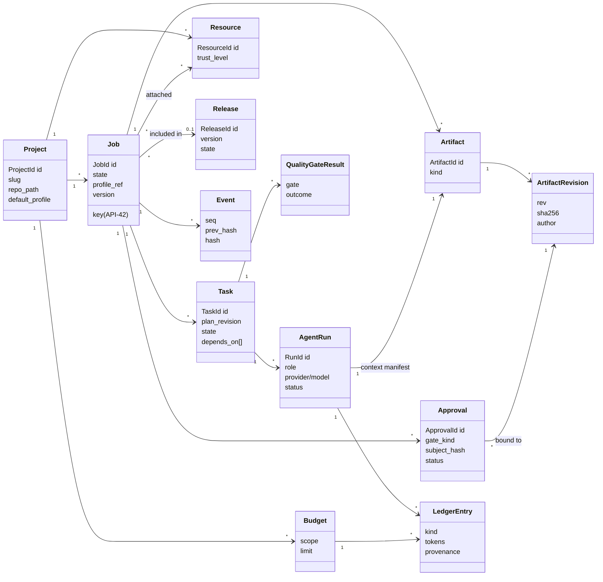

# Domain Model — Turtle Flow

| Field | Value |
|---|---|
| Document | DOMAIN-MODEL.md |
| Status | Proposed baseline |
| Related | [WORKFLOW.md](WORKFLOW.md), [DATA-MODEL.md](DATA-MODEL.md), [README glossary](README.md#4-glossary-canonical-terminology) |

This document defines the domain entities, their relationships, invariants and lifecycle ownership. It is the reference for the `turtle-domain` crate. Persistence details are in [DATA-MODEL.md](DATA-MODEL.md).

---

## 1. Bounded Contexts

The modular monolith is organized into bounded contexts. Each owns its entities; other contexts reference them by ID only.

| Context | Owns | Crate(s) |
|---|---|---|
| **Projects** | Project, ProjectSettings, ProjectCommandSet | domain, store |
| **Delivery workflow** | Job, Stage execution, Task, Plan, Approval, QualityGate result, Release | workflow, policy |
| **Agent execution** | AgentRun, ContextPackage, Transcript, ProviderCapability | agents, context, scheduler |
| **Token economy** | Budget, LedgerEntry, Reservation, Estimate, PriceTable, RoutingDecision | tokens |
| **Knowledge & resources** | Resource, ResourceVersion, Chunk, KnowledgeItem, Lesson | context, artifacts |
| **Artifacts** | Artifact, ArtifactRevision, Blob | artifacts |
| **Source control** | Worktree, Branch record, CommitRecord, DeliveryRecord | git |
| **Audit** | Event (hash-chained), Actor | store |
| **Licensing** | License, Entitlement | policy (entitlements) |

## 2. Entity Relationships

<!-- diagram: 07-domain-relationships -->


Note: stage-level agent runs (spec writer, planner, reviewer, verifier) belong to the job directly with `task_id = NULL`; implementation and fix runs belong to a task.

## 3. Entity Definitions and Invariants

### 3.1 Project

| Attribute | Type | Notes |
|---|---|---|
| `id` | `ProjectId` (ULID) | Immutable |
| `slug` | string `[a-z0-9-]{2,40}` | Unique, immutable by default |
| `key_prefix` | string `[A-Z]{2,6}` | For job keys (`API-42`), unique |
| `name`, `description` | string | — |
| `repo_path` | absolute path | Must be a non-bare Git repository |
| `default_branch` | string | Detected; protected by default |
| `default_profile` | ProfileRef | `standard` by default |
| `settings` | ProjectSettings | Commands, preferences, policies (resolved view) |
| `status` | `active` \| `archived` | — |

**Invariants**
- P-1: `repo_path` is unique across active projects (one project per repository; monorepo sub-projects are a future feature).
- P-2: An archived project accepts no new jobs; existing jobs may finish.
- P-3: All project-scoped data (jobs, resources, knowledge, budgets) is reachable only via `project_id`.

### 3.2 Job (aggregate root of the delivery workflow)

| Attribute | Type | Notes |
|---|---|---|
| `id`, `key` | JobId, `PREFIX-n` | `n` monotonic per project |
| `title`, `description`, `type` | — | `feature`/`bugfix`/`refactor`/`docs`/`chore` |
| `profile` | ProfileSnapshot | Profile **copied** at job creation (immutable unless escalated) |
| `state` | `JobState` | See [WORKFLOW.md §3](WORKFLOW.md#3-job-states) |
| `hold` | `None` \| `Paused{mode}` \| `AwaitingBudget` \| `RateLimited{until}` | Overlay, preserves `state` |
| `loop_counters` | map stage → u32 | For retry and back-transition limits |
| `complexity` | `XS`..`XL` + score | From preflight |
| `base_commit` | SHA | Set when worktree is created |
| `worktree_id` | Option | — |
| `budget_id` | BudgetId | Job budget |
| `priority` | enum | — |
| `blocked_by` | Vec<JobId> | Dependencies |
| `version` | i64 | Optimistic concurrency |

**Invariants**
- J-1: `state` changes only via `turtle-workflow::decide()`.
- J-2: At most one agent run of a job is `running` at any time (MVP).
- J-3: A job in `implementation` or later has exactly one worktree (until cleanup after terminal state).
- J-4: A job cannot enter `planning` (standard/strict) without a `valid` scope approval whose `subject_hash` equals the current spec revision hash.
- J-5: A job cannot enter `delivery` without a `valid` acceptance approval whose subject hash equals the hash of `(base_commit, head_commit, diff_sha256, verification_report_sha256)`.
- J-6: Terminal states (`done`, `cancelled`, `failed`) are final; reopening creates a new job linked via `reopened_from`.
- J-7: The profile snapshot can only be escalated (fast→standard→strict), never relaxed, after scope approval.

### 3.3 Task

Tasks come from a specific **plan revision**. If the plan is revised, tasks of the old revision are `superseded`, and tasks of the new revision are created (completed work is carried over by mapping where the planner declares `carries_over_from`).

| Attribute | Notes |
|---|---|
| `id`, `job_id`, `plan_revision`, `ordinal` | — |
| `title`, `instructions` | From plan |
| `expected_paths` | Glob list (used for conflict prediction and scope checks) |
| `criteria_refs` | Acceptance criterion IDs covered |
| `role` | Usually `implementer` |
| `complexity` | XS..XL |
| `estimate` | Token estimate snapshot |
| `state` | `pending` → `ready` → `running` → `gating` → `fixing` → `succeeded` \| `failed` \| `skipped` \| `superseded` |
| `depends_on` | TaskIds within the same plan revision |
| `commit_sha` | Turtle Flow commit after success |

**Invariants**
- T-1: The dependency graph of a plan revision is acyclic.
- T-2: A task becomes `ready` only when all dependencies are `succeeded` or `skipped`.
- T-3: A task's fix iterations ≤ profile `max_fix_iterations`.

### 3.4 AgentRun

| Attribute | Notes |
|---|---|
| `id`, `job_id`, `task_id?`, `role` | — |
| `attempt` | 1-based per (job, stage/task, role) |
| `provider`, `model`, `adapter_version`, `cli_version` | Recorded exactly |
| `routing_decision_id` | Why this provider/model |
| `context_package_sha` | Manifest artifact revision |
| `reservation_id` | Ledger reservation |
| `status` | `queued` → `starting` → `running` → `succeeded` \| `failed` \| `cancelled` \| `timed_out` \| `abandoned` |
| `error` | Classified error (code, retryable flag, provider message excerpt) |
| `session_ref` | Provider session ID if resumable |
| `lease` | Instance ID + expiry while running |
| `started_at`, `ended_at`, `exit_code` | — |
| `output_artifact_rev` | Structured output (if any) |
| `transcript_blob` | Normalized + raw transcript |

**Invariants**
- R-1: A run in `running` holds a valid lease and an open reservation.
- R-2: Every run reaching a final status has exactly one settlement ledger entry (possibly zero tokens) and its reservation is closed.
- R-3: `context_package_sha` is set before the process is spawned.
- R-4: A run never transitions from a final status.

### 3.5 Artifact and ArtifactRevision

| Kind | Producer | Consumer |
|---|---|---|
| `discovery_report` | discovery run | spec writer, planner |
| `specification` | spec writer / user edit | approval, planner, reviewer, verifier |
| `preflight_report` | token engine | scope approval |
| `plan` | planner / user edit | scheduler, reviewer |
| `context_manifest` | context builder | audit, analytics |
| `patch` | Turtle Flow (diff of worktree after run) | review, acceptance |
| `gate_result` | gate runner | workflow guards, fixer |
| `review_report` | reviewer | fixer, acceptance |
| `verification_report` | verifier + deterministic checks | acceptance |
| `transcript` | run supervisor | audit, UI |
| `release_plan`, `release_notes` | release roles | release approval |
| `job_report` | export | user |

**Invariants**
- A-1: Revisions are immutable; content stored as blob addressed by SHA-256 of canonical bytes (canonical JSON — RFC 8785 JCS — for structured artifacts).
- A-2: `rev` increments monotonically per artifact; `author` ∈ {`agent_run:<id>`, `user:<id>`, `system`}.
- A-3: A structured artifact revision is valid against its schema version, recorded on the revision.

### 3.6 Approval

| Attribute | Notes |
|---|---|
| `id`, `job_id` (or `release_id`), `gate_kind` | `scope`, `plan` (strict), `budget_increase`, `scope_change`, `acceptance`, `policy_exception`, `release` |
| `subject` | Typed reference (artifact revision(s), budget delta, etc.) |
| `subject_hash` | SHA-256 over canonical binding document (see [WORKFLOW.md §6.2](WORKFLOW.md#62-approval-binding)) |
| `binding` | JSON: artifact hashes, base commit, policy version, budget envelope, profile hash |
| `status` | `pending` → `approved` \| `rejected` \| `changes_requested` \| `expired` \| `invalidated` \| `superseded` |
| `decided_by`, `decided_at`, `comment`, `channel` | `cli_tty` \| `dashboard` |
| `expires_at` | Optional (default: none for scope; 7 days for acceptance) |
| `invalidated_reason` | e.g. `spec_revised`, `base_changed`, `budget_envelope_exceeded` |

**Invariants**
- AP-1: A decision request must echo the `subject_hash`; mismatch → rejected request (prevents approving something other than what was displayed).
- AP-2: Only actors of kind `user` can decide approvals.
- AP-3: At most one `pending` approval per (job, gate_kind).
- AP-4: An approval is *valid* iff `status = approved` ∧ not expired ∧ recomputed binding hash equals `subject_hash`.

### 3.7 QualityGateResult

`gate` (`build`, `test`, `lint`, `format_check`, `custom:<name>`, `diff_size`, `protected_paths`, `secret_scan`, `review_blockers`), `outcome` (`passed`, `failed`, `error`, `skipped`), `command`, `exit_code`, `duration_ms`, `summary` (parsed counts), `output_blob`, `head_commit`.

Invariant G-1: a gate result is tied to the exact `head_commit` and working-tree hash it ran against; a result for a different tree hash does not satisfy a guard.

### 3.8 Budget, Reservation, LedgerEntry

See [TOKEN-INTELLIGENCE.md §4](TOKEN-INTELLIGENCE.md#4-budgets-reservations-and-the-ledger).

- B-1: For hard budgets: `settled + open_reservations ≤ limit` at all times.
- B-2: A ledger entry is append-only; corrections are compensating entries.
- B-3: Each run has ≤ 1 open reservation per applicable budget.

### 3.9 Resource and ResourceVersion

- RS-1: A resource version is immutable and content-addressed.
- RS-2: Attachments reference a specific version or `latest` (resolved and recorded in each context manifest).
- RS-3: Trust level is set by the user; agent-produced content can never be `trusted`.

### 3.10 KnowledgeItem

Types: `fact`, `convention`, `decision`, `lesson`, `repo_map`, `summary`. Attributes: provenance (`user`, `agent_proposed`, `derived`), status (`proposed`, `active`, `stale`, `retired`), `scope_paths`, `valid_at_commit`, `file_hashes`.

- K-1: `agent_proposed` items are not used in context until `active` (approved).
- K-2: An item with `file_hashes` becomes `stale` when any referenced file's hash differs at the job's base commit.

### 3.11 Release

Separate aggregate ([WORKFLOW.md §8](WORKFLOW.md#8-release-workflow)). Includes delivered jobs; its own state machine; release approval mandatory (FR-156).

### 3.12 Event

`seq` (global monotonic), `id`, `occurred_at`, `project_id?`, `job_id?`, `run_id?`, `type`, `payload`, `actor_kind`, `actor_id`, `prev_hash`, `hash`. Invariant E-1: `hash = SHA256(prev_hash || canonical(event without hash))`; append-only.

## 4. Lifecycle Ownership

| Entity | Created by | Mutated by | Terminated by | Deleted by |
|---|---|---|---|---|
| Project | User (CLI/API) | User | User (archive) | User (explicit delete; data only) |
| Job | User | Workflow engine only | Engine (terminal states) | Retention policy never deletes jobs; project delete cascades |
| Task | Engine (from plan revision) | Engine/scheduler | Engine | Cascade with job |
| AgentRun | Scheduler (effect) | Run supervisor via commands | Run supervisor / recovery | Never (transcript blobs subject to retention) |
| Artifact revision | Runs, user edits, system | Never (immutable) | — | Retention for transcripts only |
| Approval | Engine (on entering approval stage) | User decision; engine invalidation | Engine | Never |
| Budget | User / defaults | User; ledger entries by engine | — | With project |
| Worktree | Git effect | Agents (files), Turtle Flow (commits) | Cleanup effect | Cleanup effect |
| Event | Writer task | Never | — | Never (except project deletion with audit export) |

## 5. Value Objects and Enums (Rust sketch)

```rust
pub struct JobKey { pub prefix: String, pub number: u32 }           // "API-42"
pub struct Sha256(pub [u8; 32]);
pub struct TokenCount(pub u64);

pub enum Complexity { XS, S, M, L, XL }

pub enum Role { SpecWriter, Planner, Implementer, Fixer, Reviewer, Verifier, Summarizer, ReleaseNotes, Discovery }

pub enum TrustLevel { Trusted, Internal, Untrusted }

pub enum UsageProvenance { Reported, Estimated, Unavailable }

pub enum Actor {
    User { id: UserId },          // MVP: single local user "local"
    System,
    Scheduler,
    AgentRun { id: RunId },
}

pub enum Hold {
    Paused { mode: PauseMode, requested_by: Actor },
    AwaitingBudget { approval_id: ApprovalId },
    RateLimited { provider: ProviderId, until: Option<OffsetDateTime> },
}
```

## 6. Distinctions Requested in the Brief

| Concept | What it is | What it is not |
|---|---|---|
| **Project** | Isolation unit bound to one repository | Not a Git branch or a team |
| **Job** | Requested change with lifecycle and approvals | Not a single agent prompt |
| **Task** | Planned unit of a job's implementation | Not independently approvable (MVP) |
| **Agent Run** | One provider process invocation | Not a "conversation" spanning stages |
| **Workflow** | Profile-configured state machine instance governing a job | Not a free-form script |
| **Approval** | Human decision bound to hashes | Not a boolean flag on a job |
| **Quality Gate** | Check required for a transition | Not an agent's self-assessment |
| **Artifact** | Immutable output revision | Not an input |
| **Resource** | User-provided input | Not automatically sent to agents |
| **Event** | Immutable fact for audit/UI | Not the source of truth for queries (state tables are) |
| **Release** | Versioned bundle of delivered jobs | Not the same as delivery |

**Delivery vs. Release.** *Delivery* integrates one job's accepted changes into an integration branch (merge or PR) — the code becomes part of the codebase. *Release* takes the state of a branch at a commit that contains one or more delivered jobs, versions it, tags it, optionally runs deploy hooks, and makes it available to users — with its own approval and rollback. A job can be delivered and never released (e.g. internal refactor batched later); a release can contain many jobs.
