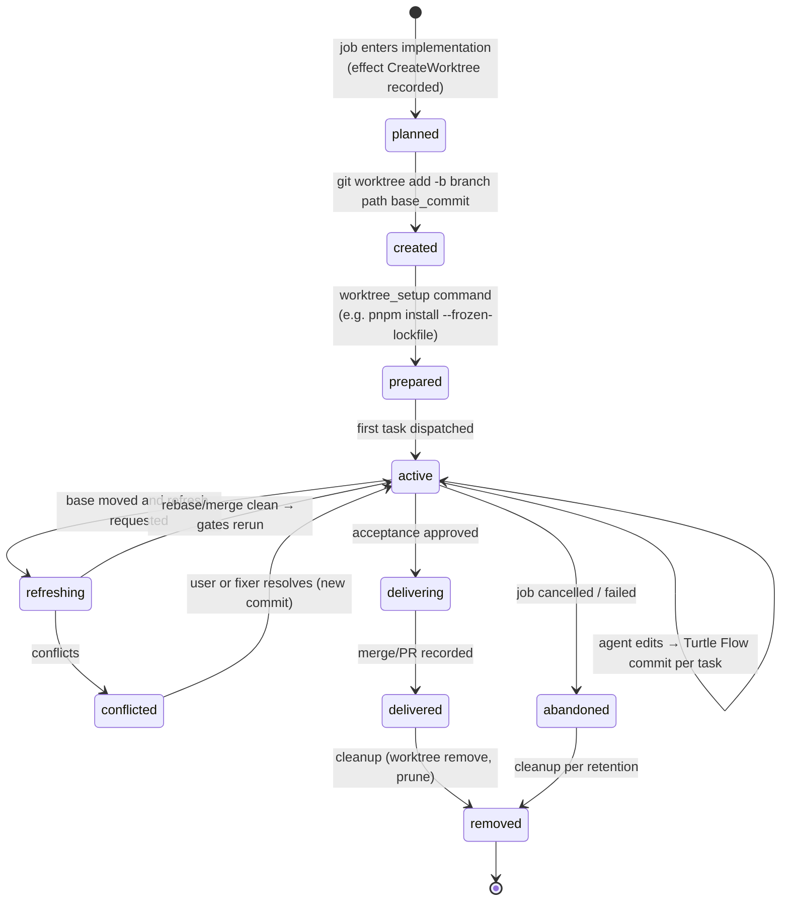

# Git Strategy — Worktrees, Branching, Commits, Delivery and Recovery

| Field | Value |
|---|---|
| Document | GIT-STRATEGY.md |
| Status | Proposed baseline; decision in [ADR-009](adr/ADR-009-git-worktree-isolation.md) |
| Related | [WORKFLOW.md §10](WORKFLOW.md#10-recovery-behavior), [SECURITY.md §6.6](SECURITY.md#66-git-hardening-sec-014) |

### Implementation status (2026-10-26)

Job worktree paths are derived from the same `Layout` used by the scheduler and can be printed with `turtle job worktree <key>`. `turtle job cancel --delete-branch` opts into removing the isolated worktree and its generated branch. `turtle job revert <key>` creates a chore job bound to its recorded delivery commit. After normal scope and plan approvals, the scheduler's idempotent worktree effect applies `git revert --no-edit` in the new job worktree; the generated revert message is the completion probe if the effect is retried after a crash. Review, verification, acceptance and delivery continue through the ordinary workflow.

---

## 1. Principles

1. **The user's main working tree is read-only to Turtle Flow** (invariant I-8). Turtle Flow never checks out, resets, stashes, or writes files in it.
2. **One job → one branch → one worktree.** Isolation of changes between concurrent jobs.
3. **Agents edit files; Turtle Flow owns Git.** Agents never commit, push, branch, rebase, reset or checkout (FR-065, FR-093). Turtle Flow creates every commit and performs every merge.
4. **Every Git mutation is an idempotent effect** with a completion probe ([ADR-017](adr/ADR-017-recovery-idempotency-crash-safety.md)).
5. **Git CLI for writes.** We shell out to `git` (≥ 2.38) for all mutations; `gix` may be used for fast read-only queries. libgit2 lacks parity for worktrees and `merge-tree --write-tree` semantics ([ADR-009](adr/ADR-009-git-worktree-isolation.md)).
6. **Worktree isolation is not security isolation** ([SECURITY.md §4](SECURITY.md#4-trust-boundaries)).

## 2. Branching Model and Naming

| Branch | Pattern | Owner | Notes |
|---|---|---|---|
| Target / integration | project `delivery.target_branch` (default: repo default branch, e.g. `main`) | User | Protected by default |
| Job branch | `turtle/<job-key>-<slug>` e.g. `turtle/API-42-add-rate-limiting` | Turtle Flow | Created from recorded `base_commit` |
| Recovery refs | `refs/turtle/recovery/<run-id>` | Turtle Flow | Stashed uncommitted agent changes after crash/hard pause; not branches (hidden from `git branch`) |
| Delivery temp | `refs/turtle/delivery/<job-key>` | Turtle Flow | Plumbing-built merge result before CAS ref update |
| Release tags | `v<semver>` (configurable) | Turtle Flow (after release approval) | Annotated |

Naming rules: `job-key` = `[A-Z]{2,6}-[0-9]+`; slug = lowercase ASCII `[a-z0-9-]`, ≤ 40 chars, derived from title, collapsing separators; full name validated with `git check-ref-format --branch`. Prefix configurable (`git.branch_prefix`).

**Protected branches** (default): the default branch, `release/*`, `hotfix/*`, plus configured patterns. Turtle Flow worktrees never check them out; they change only in the delivery or release step with a valid approval (FR-094).

## 3. Worktree Lifecycle

<!-- diagram: 09-git-worktree-lifecycle -->


### 3.1 Creation (idempotent)

```text
effect CreateWorktree { job, path, branch, base_commit }
probe:  path exists ∧ `git -C path rev-parse --abbrev-ref HEAD` == branch
        ∧ merge-base(branch, base_commit) == base_commit   → already done
action: git worktree add -b <branch> <path> <base_commit>
        (if branch exists at base_commit: git worktree add <path> <branch>)
then:   write .git/info/exclude entries for Turtle Flow scratch patterns (never committed)
        run worktree_setup (if configured) as a gate-like process with timeout
```

- Path: `~/.turtle/worktrees/<project-slug>/<job-key>/` (outside the repository, so tools scanning the main repo are unaffected and agents cannot trivially reach sibling worktrees through relative paths).
- `base_commit`: resolved at entry to implementation = tip of target branch (or job dependency's delivery commit). Recorded before creation.

### 3.2 Build caches and setup cost (practical concern)

Fresh worktrees lack build artifacts (`target/`, `node_modules/`, virtualenvs), making first gates slow. Mitigations (per-project config):

| Ecosystem | Recommendation |
|---|---|
| Rust | `CARGO_TARGET_DIR` per worktree (default) + optional `sccache`; shared target dir is possible but serializes builds via Cargo's lock |
| Node | `pnpm` content-addressed store is shared automatically; `worktree_setup = "pnpm install --frozen-lockfile --offline"` |
| Python | `uv sync --frozen` with uv's global cache |
| Go | module/build cache is global by default |
| JVM | Gradle/Maven caches global by default |

### 3.3 Cleanup

- After delivery: `git worktree remove <path>` (force only if the tree contains nothing but ignored files); branch kept for `git.branch_retention_days` (default 14) unless delivered via squash/merge and `delete_branch_after_delivery = true`.
- After cancel: worktree removed unless `--keep-worktree`; branch kept 14 days.
- Periodic maintenance: `git worktree prune`, removal of orphaned directories not in DB (after confirmation that no Git worktree metadata references them), deletion of expired branches **only** if they match Turtle Flow prefix and their tips are recorded in the DB.

## 4. Commit Policy

| Aspect | Policy |
|---|---|
| When | After each succeeded task (post-gates), and after each fix iteration that passes gates. Failed attempts are not committed (stashed to recovery refs if needed for forensics). |
| Who | Turtle Flow, via `git commit` in the worktree with `-c commit.gpgsign=false` (worktree commits) |
| Author/committer | Default: user's Git identity (from repo config) as author and committer; trailers identify the agent. Option: dedicated bot identity `Turtle Flow <turtle@localhost>` with `Co-authored-by:` user. |
| Subject | Conventional Commits: `<type>(<job-key>): <task title>` e.g. `feat(API-42): add token bucket middleware` |
| Body | Task summary (from plan), criteria covered |
| Trailers | `Turtle-Job: API-42`, `Turtle-Task: 01JB…`, `Turtle-Run: 01JB…`, `Turtle-Provider: codex`, `Turtle-Model: <model>`, `Turtle-Context: sha256:…` |
| Content checks before commit | `git status` vs. policy: no changes under `.git/`, no new files matching never-include globs (secrets), size limits (single file ≤ 5 MB unless allowed), no symlinks pointing outside the worktree |
| Staging | `git add -A` within the worktree after checks; ignored files respected |

Commit-to-run lineage is stored in `commit_records` (FR-100) and recoverable from trailers alone.

**Tasks and trailers (issue #63).** The `Turtle-Task` value of a task commit is the task's id in the `tasks` table, `<plan revision id>/<plan task id>`; job-level fix commits use `fix/<run>`. Each task commit is recorded in `commit_records` (kind `task`, with `task_id` and `run_id`) and in `tasks.commit_sha`. The trailers stay the Git-side record: before tasks run, the scheduler reads the trailer block (last paragraph only, so trailer-like lines in a task body are ignored) of every commit in `base..branch` and checks that it agrees with the table. A disagreement blocks the job as `task_state_mismatch` and is never repaired silently; only a commit made by the task's own run before the database update (crash boundary 16) is recorded. See [WORKFLOW.md §10](WORKFLOW.md#10-recovery-behavior).

## 5. Delivery Policies

| Mode | How | When to use | Requirements |
|---|---|---|---|
| `pr` | `git push origin <job-branch>`; `gh pr create --base <target> --head <branch> --title … --body-file …` | Opt-in GitHub delivery for any profile | `origin` + authenticated `gh`; other forges are not implemented |
| `local_squash` | Build squash commit with plumbing (`merge-tree --write-tree`, `commit-tree`), then compare-and-swap update of target ref (`git update-ref refs/heads/<target> <new> <old>`) | Solo developers without PR flow | Target branch **not checked out** in any worktree (see below) |
| `local_ff` | Rebase job branch onto target in the job worktree (gates rerun), then CAS fast-forward target ref | Linear history preference | Same |
| `local_merge_commit` | `merge-tree` + `commit-tree` with two parents, CAS update | Preserve task commits with merge bubble | Same |

**Checked-out target branch problem.** Updating a branch ref that is checked out in the user's main working tree would make their working tree and index inconsistent with HEAD — violating I-8. Therefore:

- If the target branch is checked out anywhere, local modes prepare the result (job branch rebased so a fast-forward is possible, or a ready squash commit at `refs/turtle/delivery/<job-key>`) and mark the job **`delivered (pending integration)`**, showing the one-line command for the user (`git merge --ff-only turtle/API-42`). A post-integration probe detects when the target contains the commit and completes the delivery record.
- Opt-in `delivery.allow_main_worktree_ff = true`: if the main worktree is **clean** and on the target branch, the turtle runs `git -C <main> merge --ff-only <ref>` (never non-ff). This is the only exception to I-8 and must be explicitly enabled.

Delivery always: (1) re-verifies acceptance approval validity (binding hash recomputed, HMAC verified), (2) runs a conflict probe, (3) performs the mutation with CAS semantics (fails safely if target moved), (4) records `delivery_record` (mode, target, resulting commit or PR URL).

## 6. Merge and Review Integration

- AI review runs on `git diff <base_commit>...<head>` (three-dot from merge base) with rename detection (`-M`), producing findings anchored to file + line ranges of the **new** side.
- For `pr` mode, the review report summary is included in the PR body (configurable) and findings may be posted as PR review comments (Future, via `gh api`).
- The acceptance approval binds `diff_sha256` of `git diff --binary --full-index <base>..<head>` (normalized: no color, fixed `diff.algorithm=histogram`, `--no-ext-diff`, `--no-textconv`).

## 7. Conflict Detection and Resolution

### 7.1 Detection

| Check | Command | When |
|---|---|---|
| Job vs. target | `git merge-tree --write-tree --name-only --messages <target> <job-branch>` (exit status 1 = conflicts) | Before delivery; every 30 min for jobs in implementation if target moved |
| Job vs. job (predictive) | Intersection of plan `expected_paths` and actual changed paths of active jobs | Before entering implementation; on each commit |
| Job vs. job (actual) | `git merge-tree --write-tree <branchA> <branchB>` | When predictive overlap exists |

`merge-tree --write-tree` is non-mutating (no worktree/index changes) — ideal for a background probe. Requires Git ≥ 2.38 (checked by `doctor`).

### 7.2 Resolution policy

| Situation | Default action |
|---|---|
| Target moved, no conflict, job before acceptance | Auto-refresh (rebase job branch in its worktree onto new target), rerun gates — profile option `auto_refresh: on_conflict_free` |
| Target moved, no conflict, after acceptance | Refresh, rerun gates, **invalidate acceptance**, re-request (T29) |
| Conflict, trivial (≤ 3 files, all within job's expected paths) | Re-implementation on the new base by a `fixer` run (see note below) — never by having an agent operate inside a stopped rebase |
| Conflict, non-trivial | `blocked` with options: let Turtle Flow attempt AI-assisted resolution, user resolves manually in worktree, replan on new base, cancel |

**Note on AI-assisted conflict resolution:** Turtle Flow never leaves a worktree in an in-progress rebase while an agent runs (fragile state, risk of the agent running Git commands). Instead: create a fresh branch from the new target, re-apply the job's *intent* via the existing diff as reference material (`git diff base..head` given as context), let the fixer produce a new implementation, then gates/review as usual. This is more expensive but robust and fully recorded. Simple textual rebases without conflicts are done by Turtle Flow deterministically.

## 8. Parallel Jobs Safety

- Separate worktrees ⇒ separate index/HEAD/files; Git handles concurrent worktrees of one repository safely for normal operations, but **ref updates and `gc` share the repository**. Therefore all Git *mutations* per repository go through a **per-repository serialized Git worker** (one mutation at a time; reads are concurrent).
- Turtle Flow disables auto-gc in its operations (`-c gc.auto=0`) and runs `git gc --auto` only from maintenance when no Turtle Flow mutation is active.
- Gate processes of two jobs run concurrently but in different directories; shared caches (Cargo registry, pnpm store) are designed for concurrency.
- Port conflicts in tests (two jobs running servers on the same port) are a real-world problem: gates receive `TURTLE_GATE_PORT_BASE` (unique per gate run) that projects can use; documented as a project adaptation.

## 9. Security Considerations

| Risk | Control |
|---|---|
| Repo hooks executing on Turtle Flow Git operations | `-c core.hooksPath=/dev/null`, `--no-verify` |
| `core.fsmonitor` / filter drivers executing code | `-c core.fsmonitor=false`; Turtle Flow checkouts in worktrees use the repo's attributes (needed for correctness, e.g. LFS); for repos flagged `untrusted`, `-c filter.<name>.process=` overrides are generated for all configured filters except `lfs` |
| Submodule URL attacks (`file://`, ext transports) | `-c protocol.file.allow=user -c protocol.ext.allow=never`; no automatic submodule init in MVP |
| Malicious branch names / paths | Turtle Flow-generated names only; `check-ref-format`; worktree paths canonicalized and verified under worktree root |
| Agent modifying `.git` of worktree (hooks, config) | Worktree `.git` is a file pointing to `<repo>/.git/worktrees/<name>`; post-run check hashes that dir's `config`, `HEAD`, and ensures no `hooks` changes in the common dir |
| Credentials in agent environment | `SSH_AUTH_SOCK`, `GIT_ASKPASS` removed; `GIT_TERMINAL_PROMPT=0` |
| Pushing to wrong remote | Delivery remote fixed in project config; push refspec explicit `refs/heads/<branch>:refs/heads/<branch>` |

## 10. Rollback and Recovery

| Scenario | Procedure |
|---|---|
| Bad task commit discovered during job | Fixer adds a new commit (history in job branch is append-only during the job); optional squash at delivery |
| Delivered change must be reverted | `turtle job revert <key>` creates a new job of type `chore` whose implementation is `git revert <delivery-commit(s)>` performed by Turtle Flow, gated and approved like any job |
| Interrupted rebase in job worktree | Recovery probe detects `rebase-merge`/`rebase-apply` dir → `git rebase --abort` → retry refresh |
| Stale `index.lock` | Removed only if no `git` process has the worktree as cwd/arg (checked via process table) and lock age > 60 s |
| Lost worktree directory | `git worktree prune`, recreate worktree from job branch (commits are in the shared object DB) |
| Corrupted job branch (should not happen) | Reconstruct from commit records (trailers) — `refs/turtle/recovery` keeps uncommitted states |

Crash-specific recovery steps: [WORKFLOW.md §10.1](WORKFLOW.md#101-step-boundaries-and-recovery-actions-crash-injection-catalogue) (boundaries 11–16, 20–25).

## 11. Audit Trail

- Every Turtle Flow Git mutation emits an event with the exact command (argv), exit code, before/after refs.
- `commit_records`: sha, job, task, run, approval (for delivery commits), context manifest hash.
- `turtle lineage <commit-sha>` prints: job → spec revision → scope approval → plan revision → task → run → provider/model → context manifest → gates → review → acceptance approval → delivery.

## 12. Edge Cases and MVP Support Matrix

| Feature | MVP support |
|---|---|
| Git LFS | Supported if `git-lfs` installed (filters honored for trusted repos) |
| Submodules | Read-only (not initialized in worktrees); jobs requiring submodule changes are rejected with explanation |
| Monorepos | Supported as one project; path-based profile escalation; sub-project scoping is Future |
| Shallow clones | Refused for delivery modes needing merge-base; `doctor` suggests `git fetch --unshallow` |
| Sparse checkout | Worktrees created with full checkout (warn on very large repos) |
| Very large repos (> 5 GB working tree) | Allowed with warning; worktree creation time measured and shown |
| Signed commits required by target | Delivery squash/merge commit signed via user's configured signing if non-interactive (`gpg-agent`/SSH agent available); otherwise PR mode recommended |
| Non-GitHub forges | Push + manual PR (URL printed) |

## 12a. Implementation Notes (`turtle-git`)

Decisions made while building the crate; the code and its tests are authoritative.

- **Every command is hardened.** All Git calls go through one builder that sets `core.hooksPath=/dev/null`, `core.fsmonitor=false`, restricted protocols, `gc.auto=0` and `GIT_TERMINAL_PROMPT=0`, inside a scrubbed environment. A test plants hooks and an fsmonitor script in a repository and checks that neither runs. Removing either setting makes it fail.
- **Delivery takes the approved target tip.** `deliver_squash_from(req, target_tip)` builds the squash commit on the tip that was probed and approved and moves the branch only if it is still exactly there. If the target moved, the result is `TargetMoved` and the other party's commit is untouched. `deliver_squash` reads the current tip and calls it.
- **Moved local targets are refreshed before delivery.** The executor compares the target with the recorded base and runs `merge-tree`. A clean result becomes one factory refresh commit on the new base; the recorded base advances and acceptance is invalidated before gates, review and verification repeat. A conflict blocks the job. The user incorporates the target into the job worktree, commits the resolution, then runs `turtle job resolve <key>`. This refresh deliberately folds earlier task commits into one commit; their original hashes remain in the event/run history but not the refreshed branch history. A retry after a crash between Git reset and database update recognizes the refreshed head.
- **GitHub PR delivery is opt-in.** `turtle project add --delivery pr` or `turtle project delivery <slug> pr` selects it. After a current acceptance check, the factory pushes the branch to `origin` without force, then uses `gh pr create` with a title and body built from the approved specification and approval hashes. The PR URL and approved head are recorded as pending. `turtle job sync <key>` queries `gh` once and marks delivery complete only when the PR is merged at that head. `turtle job sync <key> --wait` opts into foreground polling (30 seconds by default; configurable with `--interval`). There is no background merge polling. Other forges are not implemented.
- **PR jobs use a fetched remote base.** Before creating their worktree and before delivery, the executor fetches the configured target branch from `origin` using a bounded retry policy. If `origin` or the remote branch is absent, the local target remains the base. If fetch fails transiently, the scheduler retries the effect; fetch is safe to repeat because Git atomically updates the remote-tracking ref. A moved remote target is refreshed through the same `merge-tree` path as a moved local target, which invalidates acceptance and reruns the gates, review, and verification.
- **Checked-out targets are parked.** If the target branch is checked out in any worktree (main checkout included), the squash commit is stored at `refs/turtle/delivery/<job>` and the outcome is `PendingIntegration`. The documented `git merge --ff-only <ref>` works afterwards.
- **Policy snapshot.** Before a run the factory snapshots HEAD, branch, a hash of all refs, and a hash of `config`, `config.worktree` and every non-sample hook. After the run any difference is a violation. Editing files is allowed.
- **Recovery snapshots include untracked files.** `git stash create` ignores untracked files, which agents create constantly. The recovery ref is built from a temporary index (`read-tree`, `add -A`, `write-tree`, `commit-tree`), so the real index is never disturbed, and ignored files are left alone.
- **Stale lock removal is conservative.** An `index.lock` is removed only when it is at least 60 s old and no `git` process is running anywhere on the machine. A false positive delays recovery; a false negative could corrupt a live operation.
- **Commit policy.** Staged paths matching the never-include list (including any `.git` path component) refuse the commit and reset the index. Symlinks leaving the work tree and files above 5 MB are refused. Trailers are `Turtle-Job`, `Turtle-Task`, `Turtle-Run`, `Turtle-Provider`, `Turtle-Model`, `Turtle-Context`.
- **Worktree safety.** Project slug and job key are validated before they form a path, so a path can never leave the worktree root. An existing branch is reused only when it still points at the recorded base; it is never moved.

### 12b. Policy snapshot semantics and quarantine (2026-10-25)

- **What the snapshot compares.** HEAD, the current branch, the *set of ref names*, the object ids of **tags** and of the run's **own branch**, and the config/hook hash. Refs under `refs/turtle/` and other jobs' factory branches (`refs/heads/turtle/*`) are ignored, because with parallel jobs they legitimately change while an agent runs. A test creates a second job, commits on it and writes delivery and recovery refs during a run: no violation.
- **Known limitation.** An agent that moves a *non-factory, non-own* branch (for example `main`) without creating or deleting names is not detected by this check; the agent sandbox, not this check, keeps it away from other branches. Detecting it would make every delivery by another job a false alarm.
- **Quarantine** (`Repo::quarantine`) undoes a violating run: it first preserves everything the agent did (a commit on a clean tree, working changes and untracked files) at `refs/turtle/recovery/<run>`, then restores the branch, HEAD and a clean tree, deletes refs the agent created, recreates refs it deleted and resets moved tags. The job is blocked; nothing continues silently.
## 13. Git Command Catalogue (MVP)

| Purpose | Command (base flags omitted) |
|---|---|
| Validate repo | `git rev-parse --is-inside-work-tree --is-bare-repository --show-toplevel` |
| Default branch | `git symbolic-ref refs/remotes/origin/HEAD` (fallback: config/user) |
| Create worktree | `git worktree add -b <branch> <path> <base>` |
| Status | `git status --porcelain=v2 -z --untracked-files=all` |
| Diff | `git diff --binary --full-index --no-color --no-ext-diff --no-textconv <base>..<head>` |
| Commit | `git add -A && git commit -F <msgfile> --no-verify` |
| Conflict probe | `git merge-tree --write-tree --name-only --messages <a> <b>` |
| Squash build | `git merge-tree --write-tree <target> <head>` → tree; `git commit-tree <tree> -p <target> -F <msg>` |
| CAS ref update | `git update-ref refs/heads/<target> <new> <old>` |
| Recovery ref | `git stash create` → `git update-ref refs/turtle/recovery/<run> <stash-sha>` → `git reset --hard <last-turtle-commit>` && `git clean -fd` (worktree only) |
| Remove worktree | `git worktree remove [--force] <path>`; `git worktree prune` |
| Push | `git push <remote> refs/heads/<b>:refs/heads/<b>` |
| PR | `gh pr create --base <t> --head <b> --title <t> --body-file <f>` |
