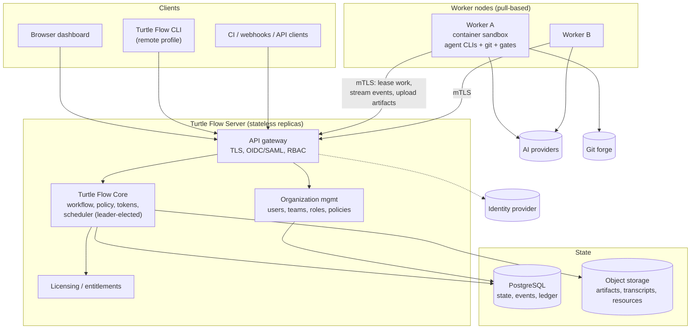

# Roadmap — MVP, Post-MVP, Turtle Flow Server and Enterprise

| Field | Value |
|---|---|
| Document | ROADMAP.md |
| Status | Proposal; dates are not committed — durations are ranges under stated assumptions. As of 2026-10-26, the feature stack through PR #26 is integrated into `main` by PR #27, with CI passing. Beta acceptance gaps are listed in [BETA-READINESS.md](BETA-READINESS.md) and the milestone snapshot in [MVP.md §6.1](MVP.md#61-progress-against-the-milestones-2026-10-26). PR merge polling is implemented by commit `5140996` and awaits integration. |
| Related | [MVP.md](MVP.md), [PRD.md §28](PRD.md#28-release-roadmap-product-view), [ADR-015](adr/ADR-015-future-server-deployment.md), [LICENSING.md](LICENSING.md) |

---

## 1. Phases at a Glance

| Phase | Releases | Goal | Primary users |
|---|---|---|---|
| **0 — Spikes** | — | De-risk provider CLIs, sandboxing, Git plumbing | Core team |
| **1 — MVP** | 0.1 → 0.3 (beta) | One reliable supervised end-to-end workflow, local | Individual developers |
| **1.5 — Intelligence & polish** | 0.4 → 1.0 | Better estimation/routing, knowledge, releases, licensing groundwork, GA | Individuals, early teams |
| **2 — Turtle Flow Server** | 2.0 → 2.x | Self-hosted multi-user server with workers | Teams, Business |
| **3 — Enterprise & managed** | 3.x | SAML/SCIM, HA, air-gap, managed cloud option | Enterprise |

**Planning assumptions (for ranges below):** core team of 3 experienced Rust engineers + 1 frontend engineer + part-time product/design; spikes complete before full build-out; no major provider CLI breaking change mid-MVP. Different staffing scales roughly linearly *only* for parallelizable epics (dashboard, adapters, analytics); the workflow engine and recovery work are serial.

## 2. Phase 0 — Spikes (≈ 2–4 weeks)

| Spike | Output | Blocks |
|---|---|---|
| S-1 Claude Code headless contract | Fixture transcripts, flag matrix | Claude adapter |
| S-2 Codex exec contract | Fixture transcripts, sandbox matrix | Codex adapter |
| S-3 Quota/rate-limit signals | Signal catalogue | Token engine UI semantics |
| S-4 Sandbox efficacy (macOS + Linux) | Read/write/network/socket matrix | SECURITY controls, approval bypass layer L3/L4 |
| S-5 Session resume billing | Repair strategy decision | Structured output |
| S-6 `merge-tree`/`commit-tree` delivery plumbing incl. CAS updates | Prototype script + tests | Delivery |
| S-7 SQLite single-writer throughput with WAL + SSE fan-out | Benchmark | Store design |

## 3. Phase 1 — MVP

Detailed epics, milestones and acceptance: [MVP.md](MVP.md).

| Release | Contents | Range (assumptions above) |
|---|---|---|
| 0.1 alpha (internal) | Vertical slice: daemon, store, CLI, Claude adapter, `fast` profile, worktree, gates, commit, local delivery | 8–12 weeks after spikes |
| 0.2 alpha | Codex adapter, `standard` profile, approvals with binding, review, verification, budgets & ledger, recovery suite, dashboard core screens | +8–10 weeks |
| 0.3 beta (= MVP) | `strict` profile, PR delivery, resources + FTS, token analytics, security essentials complete, crash-injection green, onboarding wizard | +6–8 weeks |

## 4. Phase 1.5 — Post-MVP to 1.0 GA

| Release | Theme | Key items |
|---|---|---|
| 0.4 | Intelligence | Historical quantile estimation + calibration; scoring router; project facts & repo map; lessons; `turtle eval` suite; optimization recommendations |
| 0.5 | Releases & isolation | Release aggregate, notes, tags; container isolation tier (Podman/Docker) for gates and agents; per-project provider credential isolation (OQ-03); light theme |
| 0.6 | Extensibility | Additional adapters (e.g. Gemini CLI, Aider), parallel tasks via sub-worktrees, GitLab push/PR support, optional embeddings (sqlite-vec) behind flag |
| 1.0 GA | Commercial launch | License files & Licensing screen, signed releases, docs site, stability guarantees for CLI JSON and API v1 |

## 5. Phase 2: Turtle Flow Server Architecture

**Decision ([ADR-015](adr/ADR-015-future-server-deployment.md)):** a separate `turtle-server` distribution built from the same core crates. The local `turtle` remains a first-class product (and can act as a client of a server).

<!-- diagram: 12-future-server-architecture -->


### 5.1 Component separation

| Component | Responsibility | Reuses from MVP |
|---|---|---|
| Turtle Flow Core | Workflow, policy, tokens, scheduling | `turtle-workflow`, `turtle-policy`, `turtle-tokens`, `turtle-scheduler` (leader election added) |
| Turtle Flow Server | HTTP API, auth, multi-tenancy (org), SSE | `turtle-api` + auth middleware |
| Worker Nodes | Agent execution, gates, Git worktrees; pull leases; stream events; upload artifacts | `turtle-agents`, `turtle-exec`, `turtle-git`, `turtle-context` (packaging may run on server or worker) |
| Dashboard | Same SPA, served by server; multi-user features enabled by entitlements | `dashboard/` |
| Agent Execution | Always container-isolated (Tier 2+) on workers | `turtle-exec` container backend |
| Organization Management | Users, teams, roles, project grants, approval policies | new crate `turtle-org` |
| Licensing | Entitlements from license file; seat counting | `turtle-policy::entitlements` |
| Authentication | OIDC (Business), SAML/SCIM (Enterprise), API tokens, worker mTLS | new `turtle-auth` |
| Authorization | RBAC + per-project grants + approval policies | `turtle-policy` extended |

### 5.2 Key design points

- **Persistence:** PostgreSQL implementations of the repository traits (`turtle-store-pg`); same schema concepts, `BIGSERIAL` event sequence, row-level security per organization for managed cloud.
- **Scheduler:** single active scheduler via Postgres advisory-lock leader election; effects/outbox in Postgres; workers claim leases with `SELECT … FOR UPDATE SKIP LOCKED`.
- **Workers:** pull model (outbound connections only → works behind NAT/firewalls); each lease carries the run request, context package reference, and scoped short-lived credentials (e.g. Git push token only for delivery leases). Workers hold Git mirrors per project; worktrees per job as in the MVP.
- **Credentials:** provider credentials per project or per org stored in the server secret store (or external vault) and injected into worker containers per run (requires OQ-03 resolution and provider ToS compliance — OQ-01).
- **Approvals:** multi-user approval policies (e.g. acceptance requires an `approver` other than the job creator; strict requires two approvals); binding and invalidation unchanged.
- **Local ↔ server:** the local CLI can target a server profile (`turtle --remote acme`). Migration path: export local projects (FR/NFR-014) and import into server.

### 5.3 Deployment targets

| Target | Packaging |
|---|---|
| Internal company server | Single binary + systemd unit, or Docker Compose (server + Postgres + MinIO + worker) |
| Externally hosted VM | Same as above; TLS via reverse proxy (Caddy/nginx) |
| Private cloud / Kubernetes | Helm chart: server Deployment, worker Deployment/StatefulSet, external Postgres & S3 |
| Managed cloud (future) | Vendor-operated multi-tenant control plane + customer-hosted or vendor-hosted workers |

## 6. Phase 3 — Enterprise and Managed Cloud

- SAML 2.0, SCIM 2.0, custom roles, audit streaming to SIEM (OTLP/syslog), data retention policies, legal hold.
- HA: multiple server replicas, Postgres HA, object storage replication; RPO ≤ 5 min, RTO ≤ 1 h (targets to validate).
- Air-gapped: offline license, offline update bundles, local model support for internal-only providers.
- Managed cloud: tenant isolation (separate schemas or databases per tenant, per-tenant KMS keys), customer-hosted workers option to keep source code on-prem ("hybrid").

## 7. Dependency Graph (major work items)

```text
Spikes S-1..S-7
  └─► Store + event log + outbox ─► Workflow engine (decide) ─► Scheduler + leases
                                                         │            │
          turtle-exec ─► turtle-git ─► Worktree effects┘            │
          turtle-exec ─► Adapters (Claude, Codex) ─► Run supervisor ─┘
                                   └─► Structured output + schemas
  Token ledger + reservations ─► Preflight (heuristic) ─► Historical estimation (0.4)
  API + auth ─► Dashboard core screens ─► Approvals UI ─► Analytics UI
  Recovery framework (from day 1, every effect) ─► Crash-injection suite (0.2/0.3)
  Resources + FTS ─► Context builder v2 ─► Knowledge layer (0.4)
  Entitlements abstraction (MVP) ─► License files (1.0) ─► Server (2.0)
  Repository traits (MVP) ─► Postgres store (2.0)
  Executor abstraction (MVP) ─► Remote workers (2.0)
```

## 8. MVP Decisions That Keep Later Phases Open

| Later need | MVP provision |
|---|---|
| Multi-user | `actor_kind`/`actor_id` on all events; approvals record `decided_by`; single user `local` |
| Postgres | Repository traits; no SQLite-specific SQL outside `turtle-store`; ULIDs as text |
| Remote workers | `Executor` trait between scheduler and run/gate supervisors; serialized `AgentRequest` |
| Licensing | `Entitlements` service consulted at feature boundaries |
| RBAC | `turtle-policy` authorization hook `authorize(actor, action, resource)` returning `Allow` in MVP |
| Org policies | Policy resolution already layered (defaults → Turtle Flow → project → job) |
