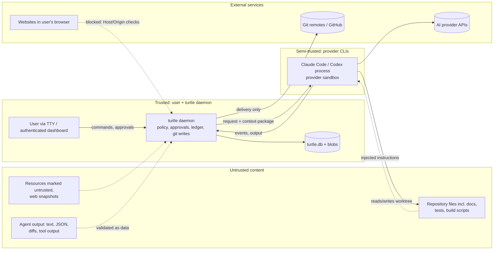

# Security Architecture and Threat Model

| Field | Value |
|---|---|
| Document | SECURITY.md |
| Status | Proposed baseline; decisions in [ADR-012](adr/ADR-012-agent-execution-security.md), [ADR-006](adr/ADR-006-supervised-autonomy-approvals.md), [ADR-016](adr/ADR-016-observability-auditability.md), [ADR-014](adr/ADR-014-licensing-architecture.md) |
| Related | [PRD.md §17](PRD.md#17-security-requirements) (SEC-xxx), [GIT-STRATEGY.md](GIT-STRATEGY.md), [TESTING-STRATEGY.md §7](TESTING-STRATEGY.md#7-security-tests-tst-13) |

---

## 1. Scope and Objectives

Turtle Flow executes AI-generated actions (file edits, shell commands) on a developer's machine, against repositories that may contain untrusted content, using credentials for paid AI services. Security objectives, in priority order:

1. **O1 — No unapproved delivery.** Code reaches protected branches only with a valid human acceptance approval bound to the exact diff.
2. **O2 — Contain agent actions.** Agent runs affect only their job worktree, cannot exfiltrate secrets, and cannot tamper with Turtle Flow state.
3. **O3 — Protect secrets.** Credentials and secrets in repositories/environments are not sent to providers or written to logs.
4. **O4 — Integrity and traceability.** Every change is attributable; tampering with history is detectable.
5. **O5 — Safe local exposure.** The local dashboard/API cannot be abused by websites or other local users.

## 2. Assets

| Asset | Location | Sensitivity |
|---|---|---|
| Source code of projects | User repos, worktrees | High (IP) |
| Provider credentials (OAuth tokens, API keys) | Managed by provider CLIs (their config dirs / OS keychain) | Critical |
| Other secrets in repos/env (`.env`, cloud keys) | Repos, shell env | Critical |
| Turtle Flow DB (approvals, ledger, events) | `~/.turtle/turtle.db` | High (integrity) |
| Artifacts, transcripts (may contain code and data) | `~/.turtle/blobs` | High |
| Dashboard credential | OS keychain + cookie | High |
| License keys (paid tiers) | OS keychain | Medium |
| Git remotes credentials | Git credential helpers | Critical |

## 3. Security Posture and Assumptions

**Decision ([ADR-012](adr/ADR-012-agent-execution-security.md)):** the MVP targets the following threat assumptions explicitly and documents what it does *not* protect against.

| In scope (MVP must mitigate) | Out of scope for MVP default mode (documented residual risk) |
|---|---|
| Prompt injection via repository files, resources, issue text, tool output | A deliberately malicious repository whose *build/test scripts* attack the host (equivalent to running `npm test` on it yourself) |
| AI agents making unintended or overreaching changes (scope creep, git writes, writes outside worktree) | A compromised provider CLI binary |
| Accidental secret leakage into prompts, logs, transcripts | Kernel/sandbox escape vulnerabilities |
| Malicious websites attacking the local dashboard (CSRF, DNS rebinding) | Other OS users with root privileges |
| Approval spoofing via agent output or stale UI | Physical access to an unlocked machine |
| Repository Git hooks / config-based code execution during Turtle Flow Git operations | Supply-chain compromise of dependencies the *project* installs during gates |
| Tampering with audit history (detectability) | A determined attacker with same-user code execution *outside* any sandbox (see §6.5) |

**Assumption A-04:** users run Turtle Flow on repositories they already trust about as much as they trust running their own builds. For untrusted repositories, the **container isolation tier** (§8, Could/post-MVP) is required.

## 4. Trust Boundaries

| Boundary | Crossing | Control |
|---|---|---|
| User → daemon | CLI over Unix socket; dashboard over loopback HTTP | Socket `0600`; dashboard token + cookie; Host/Origin checks |
| Daemon → agent | Spawn with argv/env/stdin | Env allowlist; no Turtle Flow secrets; provider sandbox; tool policy |
| Agent → daemon | stdout events, files in worktree | Parsed as untrusted data; schema validation; post-run policy checks |
| Repo content → agent prompt | Context packaging | Trust labels, data delimiters, redaction, size limits |
| Daemon → Git | Git CLI | Hooks disabled, sanitized config, protected branch guards |
| Daemon → remotes | push / PR | Only in delivery step, only with valid acceptance approval |
| Browser → daemon | HTTP | Loopback bind, auth, CSRF/rebinding defenses, CSP |

**Git worktree ≠ sandbox.** A worktree isolates *changes* between jobs (separate index, HEAD and working files). It does not restrict which files a process can read or write, nor network access. All security isolation comes from the execution layers in §8.

## 5. Threat Model

STRIDE-oriented, organized by the threat areas requested. Severity: Critical / High / Medium / Low (impact × likelihood in the MVP context).

| ID | Threat | Vector | Severity | Primary controls | MVP |
|---|---|---|---|---|---|
| TH-01 | **Prompt injection** causing agent to exfiltrate data or make harmful changes | Instructions in README, code comments, test fixtures, resources, issue text, tool output | High | Data delimiters + trust labels (SEC-010); provider sandbox with network off (SEC-005); tool deny lists (SEC-006); deterministic guards & human acceptance; protected-path flags (SEC-011); scope conformance gate | Yes |
| TH-02 | **Malicious repository content** executing code during Turtle Flow operations | Git hooks, `core.fsmonitor`, filters, `.gitattributes` drivers, submodule URLs | High | Hooks disabled, `core.fsmonitor=false`, no submodule auto-update, `protocol.file.allow=user`, sanitized `-c` overrides (SEC-014) | Yes |
| TH-03 | Malicious build/test scripts during gates | `package.json` scripts, `build.rs`, Makefiles | High (residual) | Process limits & env scrub (SEC-004/007); container tier for untrusted repos (SEC-018); clearly documented | Partial |
| TH-04 | **Untrusted AI output** treated as authoritative | Agent claims "tests pass", JSON with extra fields, path traversal in reported files | High | Turtle Flow runs gates itself; schema validation with `additionalProperties: false`; changed files computed via Git, not agent claims; paths canonicalized | Yes |
| TH-05 | **Arbitrary command execution** by agent beyond policy | Bash tool, scripts written then executed | High | Provider sandbox (workspace-write, no network); allowlisted commands where supported; post-run checks; per-run timeouts and rlimits | Yes |
| TH-06 | **Secret exposure** to providers | `.env`, credentials in repo, env vars, gate output with tokens | Critical | Never-include globs; secret scanner + redaction on context packages and transcripts (SEC-003); env allowlist (SEC-004); new-secret gate on diffs | Yes |
| TH-07 | **Credential theft** (provider tokens, Git credentials) | Agent reads `~/.claude*`, `~/.codex`, `~/.ssh`, keychain | Critical | Provider sandbox read restrictions where available (spike S-4); container tier; Turtle Flow never stores provider credentials (SEC-012) | Partial |
| TH-08 | **Filesystem permission** weaknesses | World-readable data dir, transcripts | Medium | `0700`/`0600` (SEC-013); umask set at daemon start | Yes |
| TH-09 | **Git repository attacks** | Crafted refs/branch names, path traversal in worktree names, symlink tricks, huge objects | Medium | Branch/slug validation; worktree paths generated by Turtle Flow; `core.symlinks` default respected but diff review flags symlinks; size limits | Yes |
| TH-10 | **Dependency supply-chain** risk in generated changes | Agent adds typosquatted/malicious package | High | Dependency change gate (SEC-016) & review prompt; acceptance highlights manifest/lockfile diffs; network-off sandbox prevents install during agent run unless allowed | Yes (flagging) |
| TH-11 | Supply chain of **Turtle Flow itself** | Compromised crate, CI | High | `cargo-deny`, `cargo-audit`, pinned lockfile, reproducible-ish builds, signed releases, SBOM (SEC-020) | Yes |
| TH-12 | **Resource file trust** abuse | Untrusted PDF/Markdown with injection; parser exploits | Medium | Trust levels; text extraction in-process with memory limits; PDF extraction in a subprocess with timeout; never executed | Yes |
| TH-13 | **Local dashboard** attacks | CSRF from malicious site, DNS rebinding, other local users | High | Loopback only (SEC-001); auth token → HttpOnly SameSite=Strict cookie; strict `Host` allowlist (`127.0.0.1:<port>`, `localhost:<port>`); `Origin` check on state-changing requests; no CORS; CSP `default-src 'self'` (SEC-002) | Yes |
| TH-14 | **Remote server authentication** (Phase 2) | Credential stuffing, token theft | High | OIDC/SAML, MFA via IdP, short-lived tokens, mTLS for workers | Phase 2 |
| TH-15 | **Audit log tampering** | Editing SQLite to hide/alter approvals | Medium | Hash chain + `turtle audit verify` (SEC-009); optional periodic anchoring of chain head to an external file/log | Yes |
| TH-16 | **Approval bypass** | Agent output imitating approval; agent calling local API; replaying stale approvals; editing DB | Critical | §6.5 | Yes (layered) |
| TH-17 | **Least-privilege** violations | Reviewer with write access; gates with full env | Medium | Role-based tool policies; env allowlists per process type | Yes |
| TH-18 | **Licensing** abuse/attacks | Forged license, tampered binary | Low (business) | Ed25519 signatures, offline verify; no DRM that harms users (ADR-014) | Later |
| TH-19 | Denial of service by runaway agents | Infinite loops, fork bombs, disk fill | Medium | Timeouts, output caps, rlimits (`RLIMIT_NPROC` on Linux where feasible, `RLIMIT_FSIZE`), disk-space watchdog pausing jobs < 5 GB free | Yes |
| TH-20 | Transcript/data leakage via exports | Job reports shared externally containing secrets | Medium | Redaction applied at capture; export warns and re-scans | Yes |

## 6. Controls in Detail

### 6.1 Execution layering (summary; tiers in §8)

1. Provider-native sandbox / permission mode per role (read-only vs. workspace-write; network off).
2. Turtle Flow process runner: own process group, env allowlist, timeouts, output caps, rlimits, scratch `TMPDIR`.
3. Post-run verification: Git refs unchanged, no writes in `.git/` config/hooks, scope conformance, secret scan of diff.
4. Deterministic gates and human acceptance before delivery.

### 6.2 Environment scrubbing (SEC-004)

Agent processes receive only: `PATH` (sanitized), `HOME`, `USER`, `LANG`/`LC_*`, `TERM=dumb`, `TMPDIR` (per run), provider-specific auth variables explicitly configured by the user (e.g. `ANTHROPIC_API_KEY` when API-key mode is configured), and `TURTLE_RUN_ID`. Gate processes receive the project-configured allowlist (e.g. `CARGO_HOME`, `RUSTUP_HOME`, `NODE_OPTIONS`) plus the above minus provider credentials. Turtle Flow internal tokens are never passed.

### 6.3 Secret detection and redaction (SEC-003)

- **Never-include globs** (default): `.env*`, `*.pem`, `*.key`, `id_*`, `*.p12`, `*.keystore`, `.npmrc`, `.pypirc`, `**/secrets/**`, `*.tfstate`, plus project config.
- **Scanner:** regex rules for common providers (AWS, GCP, Azure, GitHub, Slack, Stripe, OpenAI/Anthropic key formats, private key blocks, JWTs) + Shannon entropy heuristic for long tokens in assignment contexts. Implemented in Rust (no network).
- **Where applied:** context packages (before send), gate output (before inclusion in fixer context), transcripts (before persistence), job exports, diffs (new-secret gate).
- **Redaction format:** `[REDACTED:aws_access_key:sha256-8]` preserving a short hash so repeated occurrences correlate without revealing content.
- Limitation: agents can still read secrets from disk themselves when sandbox permits reads; the never-include list prevents *Turtle Flow* from sending them, and the sandbox/tool policy is the control for agent reads (spike S-4).

### 6.4 Local dashboard and API (SEC-001, SEC-002)

- Bind `127.0.0.1:<port>` and `[::1]:<port>` only; random port by default stored in `~/.turtle/run/`; MVP builds refuse non-loopback binds.
- `turtle dashboard` creates a one-time login code (128-bit, 60 s TTL) and opens `http://127.0.0.1:<port>/login#code=…` (fragment avoids server logs/referrers); the SPA exchanges it for an `HttpOnly; SameSite=Strict; Path=/` session cookie (session 12 h, sliding).
- Every request: `Host` must be in the allowlist; state-changing requests require `Origin` equal to the server origin and a custom header (`X-Turtle-Request: 1`) — defeating CSRF and DNS rebinding.
- CSP: `default-src 'self'; script-src 'self'; style-src 'self' 'unsafe-inline'; connect-src 'self'; frame-ancestors 'none'`. No third-party assets. `X-Content-Type-Options: nosniff`, `Referrer-Policy: no-referrer`.
- CLI uses the Unix socket (`0600`); peer credentials (`SO_PEERCRED`/`getpeereid`) verify the same UID.

### 6.5 Approval bypass prevention

Approval integrity is the most important property of the product and the hardest to guarantee when agents run as the same OS user. Layered controls:

| Layer | Control | Defeats |
|---|---|---|
| L1 | Approvals can only be created by `decide` handlers for authenticated user channels; agent output is never parsed for approval intents | Agent text "I approve" / fake JSON |
| L2 | Decision requests must echo `subject_hash`; guard recomputes binding at transition time | Stale UI, swapped artifacts, post-approval changes |
| L3 | Agent sandbox denies network (incl. loopback where the sandbox supports it) and the tool policy denies `curl`/`wget`/`nc`/`socat` and access to `~/.turtle` | Agent calling local API |
| L4 | Unix socket peer check: reject requests whose peer PID descends from an active agent run's process group (best-effort; PIDs tracked by run supervisor) | Agent using the CLI from inside its sandbox |
| L5 | Dashboard session cookie not readable from filesystem (in-memory server-side session table; only cookie hash persisted); dashboard login code requires interactive `turtle dashboard` with TTY | Agent obtaining dashboard credentials |
| L6 | Hash-chained events + approvals table with per-row HMAC keyed by a secret held in the OS keychain (macOS Keychain ACL bound to Turtle Flow binary; Linux Secret Service) | Direct DB edits forging approvals (detected at guard time: HMAC mismatch → approval invalid + security event) |
| L7 | Delivery guard re-verifies approval HMAC, binding hash, and audit-chain continuity for the job's events | Combined tampering |
| L8 (opt-in) | Container / separate-OS-user isolation for agent runs: agent cannot reach socket, DB or keychain at all | Same-user attacks entirely |

Residual risk (documented, top-10 risk in [ARCHITECTURE-REVIEW.md](ARCHITECTURE-REVIEW.md)): on Linux without a keyring ACL and without container isolation, a same-user process outside any sandbox could in theory read the HMAC key; L8 is the complete mitigation.

> **Implementation status of the layers above.** L1 (agents cannot decide: only users, enforced in the store and the engine), L2 (hash echo, plus recomputation at guard time) and L7-style re-verification at guard time are implemented and mutation-tested. **L6 (per-row HMAC with a keychain-held key) is not implemented yet**, so a same-user process that edits the database file can still forge an approval row; the guard recomputation limits what a forged row can approve, but does not prevent it. L3–L5 and L8 depend on the sandbox spike (S-4) and the daemon.

### 6.6 Git hardening (SEC-014)

All Turtle Flow Git invocations use: `git -c core.hooksPath=/dev/null -c core.fsmonitor=false -c protocol.file.allow=user -c submodule.recurse=false -c credential.helper= (only for non-delivery operations) …`, with `GIT_TERMINAL_PROMPT=0`, `GIT_CONFIG_NOSYSTEM=1` for read-only probes, and explicit `--no-verify` where hooks would run. Delivery operations that need user credentials (push) use the user's credential helper but still disable hooks. See [GIT-STRATEGY.md §9](GIT-STRATEGY.md#9-security-considerations).

### 6.7 Audit log (SEC-009)

- Each event: `hash = SHA-256(prev_hash ‖ canonical_json(event_without_hash))`. Genesis hash = SHA-256 of Turtle Flow instance ID.
- `turtle audit verify [--project]` walks the chain; output: OK or first broken `seq`.
- Security-relevant events (`policy_violation`, `approval_invalidated`, `audit_mismatch`, `sandbox_disabled`, `policy_exception_granted`) are additionally written to `logs/security.log` (append-only file opened with `O_APPEND`).
- Optional anchoring: daily chain head written to a user-chosen location (e.g. a Git notes ref in a private repo) for external tamper evidence (Future).

### 6.8 Supply chain (SEC-020)

- Turtle Flow: `cargo-deny` (advisories, licenses, bans, sources), `cargo-audit` in CI; `Cargo.lock` committed; dashboard `pnpm` lockfile with `--frozen-lockfile`, `npm audit` gating; release artifacts signed (cosign keyless or minisign), SBOM (CycloneDX) attached.
- Generated changes: dependency-change detection parses manifests/lockfiles (Cargo, npm/pnpm/yarn, pip/uv/poetry, Go modules, Maven/Gradle) and lists added/upgraded packages in the review and acceptance views.

## 7. Credential Management

- **Provider credentials:** owned by provider CLIs (their login flows, their storage). Turtle Flow never reads, copies or stores them (SEC-012). Consequence: credentials are per OS user, not per project. Per-project credentials require isolated CLI config dirs (OQ-03, Team tier).
- **API-key mode:** if a user prefers API keys, they are stored in the OS keychain via the `keyring` crate and injected only into that provider's agent processes as the documented env variable.
- **Git credentials:** user's existing credential helpers / SSH agent; used only by delivery push. Agent processes run with `SSH_AUTH_SOCK` removed and `GIT_TERMINAL_PROMPT=0`.
- **Turtle Flow secrets:** dashboard session signing key, approval HMAC key, license keys → OS keychain. On systems without a keychain, a `0600` file with a loud warning (`doctor` reports it).

## 8. Isolation Tiers

| Tier | Name | What runs where | Protects against | MVP status |
|---|---|---|---|---|
| 0 | Provider sandbox | CLI-native sandbox/permissions (e.g. Codex `workspace-write`, Claude Code permission rules and sandbox settings) | Accidental writes outside worktree, network exfiltration (if network disabled) | **Must** (default) |
| 1 | Turtle Flow runner hardening | Tier 0 + env scrub, rlimits, timeouts, process groups, post-run checks | Runaway processes, env secret leakage, git writes | **Must** (default) |
| 2 | Container isolation | Agent and/or gate processes inside rootless Podman/Docker with only the worktree mounted, no network (or allowlist proxy), resource limits | Malicious build scripts, credential theft, Turtle Flow state tampering | **Could** (opt-in; required for `untrusted` repos) |
| 3 | VM / separate OS user | Agent runs as dedicated low-privilege user or in a microVM (Lima/Firecracker) | Kernel-level and same-user attacks | Future |

Practical issue with Tier 2 for agents: provider CLIs need their credentials inside the container. Options: mount a dedicated credential directory (per-project credentials, OQ-03) or API-key injection. This is why Tier 2 is opt-in and post-spike.

## 9. Critical Security Controls Required for the MVP

| # | Control | Requirement |
|---|---|---|
| 1 | Loopback-only server, token + cookie auth, Host/Origin checks, CSP | SEC-001, SEC-002 |
| 2 | Provider sandbox modes enforced per role; bypass modes require policy exception approval | SEC-005, SEC-006 |
| 3 | Env allowlist for agent and gate processes | SEC-004 |
| 4 | Secret never-include globs + scanner/redaction for context, transcripts, exports | SEC-003 |
| 5 | Git hooks/fsmonitor disabled for all Turtle Flow Git operations | SEC-014 |
| 6 | Agents cannot commit/push; post-run Git policy check | FR-093, FR-065 |
| 7 | Hash-bound approvals with recomputation at guard time; TTY/dashboard-only channels | SEC-008 |
| 8 | Hash-chained audit log + approval HMAC | SEC-009 |
| 9 | Protected paths & dependency changes flagged at acceptance | SEC-011, SEC-016 |
| 10 | Timeouts, output caps, rlimits, process-group kill | SEC-007 |
| 11 | Data dir permissions | SEC-013 |
| 12 | Repo config cannot relax security policy | SEC-015 |
| 13 | Signed releases, cargo-deny/audit | SEC-020 |

## 10. Security Events and Response

| Event | Trigger | Automatic response | User action |
|---|---|---|---|
| `policy_violation.git` | Agent changed refs/HEAD/branch | Run failed; changes stashed to recovery ref; job `blocked` | Inspect; resume or cancel |
| `policy_violation.write_outside` | Watched path modified during run | Job `blocked`; all jobs of project paused (configurable) | Investigate |
| `secret_detected.context` | Secret found during packaging | Redacted; event recorded | Optionally add path to never-include |
| `secret_detected.diff` | New secret in agent diff | Gate fails; fixer instructed to remove | Review |
| `approval_integrity_failure` | HMAC/binding mismatch | Approval invalidated; delivery blocked; security log | Re-approve after review; run `audit verify` |
| `audit_chain_broken` | Verify detects break | All deliveries blocked until acknowledged | Investigate DB integrity |
| `sandbox_unavailable` | Provider sandbox capability missing | Implementer role refuses to run on that provider | Upgrade CLI / choose another provider / policy exception |

## 11. Phase 2 (Server) Security Preview

- Authentication: OIDC (Business), SAML + SCIM (Enterprise); local accounts only for evaluation.
- Authorization: RBAC (`viewer`, `developer`, `approver`, `project_admin`, `org_admin`, `auditor`) + project-level grants; approval policies (e.g. "acceptance for `strict` requires approver ≠ job creator").
- Worker nodes: mTLS with per-worker certificates; workers pull leases; workers never receive more secrets than their run needs; runs always Tier 2+.
- Transport: TLS 1.3; HSTS; audit log export to SIEM (syslog/OTLP).
- Multi-tenancy (managed cloud, future): per-tenant encryption keys, strict tenant isolation in DB (row-level security in Postgres) and in workers (no shared worker across tenants).

## 12. Residual Risks (accepted for MVP, documented to users)

1. Same-user execution means Tier 0/1 isolation depends on provider sandbox quality (TH-07, TH-16 residual).
2. Gate execution runs the project's own scripts with the user's privileges (TH-03).
3. Secret scanning is heuristic; false negatives possible (TH-06).
4. Prompt injection cannot be fully prevented; we rely on containment and deterministic checks rather than detection (TH-01).
