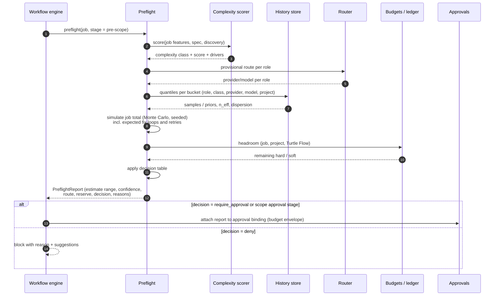

# Token Intelligence Engine

| Field | Value |
|---|---|
| Document | TOKEN-INTELLIGENCE.md |
| Status | Baseline with usage accounting and M3 part 2 quota/rate-limit handling implemented; decisions in [ADR-008](adr/ADR-008-token-intelligence-budgets.md) and [ADR-018](adr/ADR-018-model-routing-and-evaluation.md) |
| Related | [AGENT-PROTOCOL.md](AGENT-PROTOCOL.md), [DATA-MODEL.md](DATA-MODEL.md), [examples/example-preflight-report.json](examples/example-preflight-report.json) |

---

## 1. Purpose and Scope

The Token Intelligence Engine (crate `turtle-tokens`) answers four questions before and during every job:

1. **How much will this cost?** (estimation with honest uncertainty)
2. **May we spend it?** (budgets, reservations, approvals)
3. **Who should do it?** (provider/model routing, jointly with [ADR-018](adr/ADR-018-model-routing-and-evaluation.md))
4. **What did it actually cost, and what did we learn?** (accounting, analytics, feedback into estimation)

It is deterministic code. It does not call an LLM to estimate tokens.

## 2. Six Kinds of Capacity Data — Never Conflated

| # | Kind | Source | Storage | Display rule |
|---|---|---|---|---|
| 1 | **Measured usage** | Provider-reported counts parsed from CLI output | `usage_records` with `provenance = reported` | Exact number |
| 2 | **Estimated usage** | Turtle Flow estimator (pre-run), or post-run approximation when the provider reports nothing | `estimates`; `usage_records` with `provenance = estimated` | Range (P10–P90) + confidence, or "≈ N (estimated)" badge |
| 3 | **User budget** | Configuration | `budgets` | Limit bars with settled/reserved split |
| 4 | **Provider rate limits** | Rate-limit errors/messages; headers only if CLI exposes them | `provider_limits_observed` | "Rate limited until HH:MM" or "rate-limited (reset unknown)" |
| 5 | **Provider account quota** | Only if a CLI exposes it (not assumed) | `provider_quota_snapshots` with `status ∈ {known, partial, unknown}` | "unknown" by default |
| 6 | **Unknown capacity** | Absence of data | explicit `unknown` | Grey "unknown" badge; never a number, never 0, never ∞ |

**Rule:** no API response field may carry a bare number for kinds 2, 4 or 5 without an accompanying `provenance`/`status` field. This is enforced by response types (`Measured<u64>`, `Estimated { p10, p50, p90, confidence }`, `Quota::Unknown`).

## 3. Usage Accounting

### 3.1 Capture

- Adapters emit `Usage` events (per turn if available, final otherwise). The run supervisor keeps a running cumulative total and the final authoritative total (final event wins; if absent, sum of per-turn deltas; if absent, estimate).
- **Estimated fallback:** if no usage is reported, input ≈ approximate tokens of rendered prompt + context + tool results observed in transcript; output ≈ approximate tokens of assistant text + tool call inputs. Approximation uses a per-model ratio (bytes/token) calibrated from runs where usage *was* reported; default 4 bytes/token. Provenance `estimated`, with the method recorded.
- **Per-model breakdown:** if the provider reports sub-model usage (e.g. a smaller model used internally), it is recorded per model.

### 3.2 Attribution

Every usage record carries `(installation_id, project_id, job_id, task_id?, run_id, role, stage, provider, model, attempt, is_retry, is_repair)`. Aggregations are SQL views over `usage_records` joined with `agent_runs`; no denormalized counters are authoritative (counters exist only as cached projections rebuilt from records).

### 3.3 Cached tokens

Cached input tokens are tracked separately because they are priced differently and because context packaging strategies (stable prefixes) affect cache hit rate. Analytics show `cache_read / input` per role.

## 4. Budgets, Reservations, and the Ledger

### 4.1 Budget scopes

| Scope | Period | Typical limit | Hard/soft default |
|---|---|---|---|
| Turtle Flow | calendar month (configurable) | user-defined | soft |
| Project | calendar month | user-defined | hard |
| Job | lifetime | from preflight envelope (approved with scope) | hard |
| Task | lifetime | derived from plan estimate × factor (default 2.0) | soft (warn + auto-escalate to job budget) |

Units: tokens (total, or input/output separately) and/or currency (computed from price table). A budget can be token-only, cost-only, or both (both enforced).

### 4.2 Ledger

Append-only `ledger_entries`:

| Kind | Effect on budget | When |
|---|---|---|
| `reserve` | `reserved += amount` | Before a run starts (atomic across all applicable budgets) |
| `settle` | `reserved -= reservation; settled += actual` | Run final |
| `release` | `reserved -= reservation` | Run cancelled before start / never started |
| `adjust` | `settled ± amount` | Corrections (e.g. late usage data from recovery) |
| `limit_change` | `limit = new` | Approved budget increase / user edit |

Invariant B-1 (hard budgets): `settled + reserved ≤ limit` must hold **after every reserve**. Reservation is atomic across scopes in one transaction: either all budgets (task, job, project, Turtle Flow) accept, or none.

**Overrun honesty:** if a provider does not stream usage, a run can exceed its reservation. The overrun is settled truthfully (budget shows over-limit), an `overrun` event is emitted, no further runs start under that budget, and estimation buffers for that bucket increase automatically. Mid-run termination at a hard limit is applied only when cumulative usage is streamed (`usage_reporting = PerTurn`).

```rust
pub struct ReservationRequest {
    pub run_id: RunId,
    pub scopes: Vec<BudgetId>,           // task?, job, project, Turtle Flow
    pub tokens: u64,                     // P90 × (1 + buffer)
    pub cost: Option<Money>,
}

pub enum ReservationOutcome {
    Reserved { reservation_id: ReservationId },
    Denied { budget_id: BudgetId, headroom: u64, requested: u64, hard: bool },
}
```

### 4.3 Implementation status (2026-10-25)

*Provider quirk:* when Claude Code cuts a run off (for example `error_max_budget_usd`) the final event's top-level `usage` is all zeros while `modelUsage` holds the real spend. The adapter takes the larger of the two (spike S-1 run 04, fixture `04-max-budget-stop.ndjson`).

Implemented in `turtle-store::ledger` and used by the executor: the budget scopes job (lifetime), project and global (monthly, rolled over into a new period row), `reserve` (atomic across scopes, B-1 checked inside the transaction), `settle`, `release`, overrun events, `abandon_open_runs` on restart, and `verify_ledger` (cached `settled`/`reserved` recomputed from the entries). Differences from the design above, all deliberate for now:

- The unit is **tokens processed** (input, cache reads and writes, output). Currency budgets and the price table are not built.
- The task scope is not used. Reservations use historical P90 × (1 + confidence buffer) when reported runs exist for the role/complexity bucket, and retain the original fixed per-role size for a cold start. The `ledger.reserved` event records the estimate range, confidence and bucket level.
- A failed run with reported final usage is recorded as *reported* and charged at settlement; it does not train the estimator because an aborted run is not representative of a normal run. A failed run with no usage remains `unavailable` and releases its reservation. A successful run that reports nothing is charged the reservation.
- The budget-increase approval of §6.3 is not wired in. A held job (`awaiting_budget`, no attempt used) is resumed by raising the budget (`turtle budget set`), which is recorded as a `limit_change` entry; the scheduler then lifts the hold, because `BudgetRestored` is a machine-only command.
- `turtle budget estimate <job-key>` and `turtle job show` expose planned-job ranges and confidence after the plan exists. The scheduler freezes the same role-mix estimate in a plan-hash-bound `PreflightReport`; in `standard`, an envelope above an explicitly configured job token limit requires plan approval. Scope and plan approval bindings include the configured job limit so edits invalidate stale approvals. A job remains unbudgeted unless the user sets a limit.

## 5. Complexity Estimation

Complexity is computed deterministically from features available at each stage, then optionally adjusted by the spec writer's self-assessment (bounded to ±1 class).

| Feature | Available after | Weight (initial) |
|---|---|---|
| Job type (`docs` < `chore` < `bugfix` < `refactor` < `feature`) | creation | 10 |
| Description length & attachment count | creation | 5 |
| Acceptance criteria count | specification | 15 |
| Affected areas / estimated files touched | discovery/spec | 20 |
| Size (LOC) of affected files | discovery/spec | 15 |
| Languages involved | discovery | 5 |
| Risk tags (`security`, `migration`, `concurrency`, `public_api`, `data_loss`) | spec | 20 |
| Plan task count and dependency depth | planning | 10 (re-scored) |

`score ∈ [0,100]` → class: **XS** < 10 ≤ **S** < 25 ≤ **M** < 50 ≤ **L** < 75 ≤ **XL**. Weights are configuration, and recalibrated offline against actual token usage (post-MVP: simple linear regression on log tokens).

Current implementation uses only summary/in-scope text length, acceptance criteria, affected areas, named risk tags and plan task/dependency count. It normalizes their available weights to 100. Job type, attachments, affected-file LOC, languages and agent self-assessment have no structured input in the current spec/plan, so they are omitted. The weights are compiled defaults, not configuration yet.

**XL policy:** preflight recommends splitting the job; proceeding requires explicit approval.

## 6. Preflight

Preflight runs (a) at job level before scope approval, (b) again after planning (refined with task-level estimates), and (c) before each agent run (run-level reservation).

<!-- diagram: 06-token-preflight-sequence -->


### 6.1 Preflight pseudocode

```text
function preflight(job, stage):
    features   = collect_features(job, stage)
    complexity = complexity_scorer.score(features)                 # class + drivers
    roles      = expected_runs(job.profile, complexity, stage)     # e.g. [spec, plan, impl×k, fix×E, review, verify]
    routes     = { r: router.provisional(r, complexity, job.project) for r in roles }

    samples = []
    for i in 1..N (N = 2000, seed = hash(job.id, stage)):
        total = 0
        for run in roles:
            q = history.distribution(run.role, complexity, routes[run.role], job.project)
            total += q.sample_lognormal(rng)
        total += sample_fix_loops(job.profile, complexity, routes, rng)      # Bernoulli/geometric from history
        total += sample_backtransitions(job.profile, complexity, rng)
        samples.append(total)

    est = { p10: quantile(samples, .10), p50: quantile(samples, .50), p90: quantile(samples, .90) }
    confidence = confidence_from(min_n_eff over buckets, dispersion)
    buffer     = { high: 0.15, medium: 0.25, low: 0.50 }[confidence]
    envelope   = ceil(est.p90 * (1 + buffer))

    headroom = budgets.headroom(job)     # min over hard scopes
    decision, reasons = decision_table(est, envelope, headroom, complexity, confidence, routes, job.profile)

    return PreflightReport { complexity, est, confidence, routes, envelope,
                             cost: price(est, routes), retry_cost: expected_retry_cost(...),
                             decision, reasons }
```

### 6.2 Decision table (job-level)

Evaluated top to bottom; first matching row wins.

| # | Condition | Decision | Notes |
|---|---|---|---|
| 1 | No eligible provider for a required role | `deny` | Reason lists missing capability/auth |
| 2 | `est.p50 > headroom_hard` | `deny` | Suggest: split job, cheaper route, budget increase |
| 3 | `complexity = XL` | `require_approval` | Recommend split; shows drivers |
| 4 | `envelope > headroom_hard` (but p50 fits) | `require_approval` | Budget-increase may be needed later |
| 5 | `confidence = low` ∧ `est.p90 > 0.5 × project_remaining` | `require_approval` | Low confidence on a large share |
| 6 | `envelope > profile.max_job_tokens_without_approval` | `require_approval` | Profile threshold |
| 7 | otherwise | `allow` | In standard/strict, scope approval still occurs; `allow` only matters for auto-scope in `fast` |

### 6.3 Decision table (run-level, before each agent run)

| # | Condition | Action |
|---|---|---|
| 1 | Reservation `Reserved` | Start run |
| 2 | Denied on soft budget | Start run; emit `soft_budget_exceeded` warning |
| 3 | Denied on job hard budget, job within approved envelope × 1.0 but job budget smaller (misconfig) | `awaiting_budget` hold |
| 4 | Denied on project/global hard budget | `awaiting_budget` hold + notification |
| 5 | Reservation would exceed approved envelope | Invalidate scope approval's budget part → `budget_increase` approval |

### 6.4 Example preflight report (abridged)

The current CLI preflight sums sequential spec, plan, implementation, review and verification runs (plus discovery when enabled by the profile). It uses only route-independent role/class history because the CLI has no provisional route. It checks configured token-budget headroom; provider eligibility and profile token thresholds are not available to it. Retry and fix-loop probabilities (§11) are not measured yet, so the displayed range and decision exclude rework; the CLI labels this limit. This is an advisory calculation after planning, not an automatic approval gate.

```json
{
  "job": "API-42",
  "stage": "pre_scope",
  "complexity": { "class": "M", "score": 41, "drivers": ["criteria:6", "files~14", "risk:public_api"] },
  "estimate_tokens": { "p10": 310000, "p50": 520000, "p90": 910000 },
  "confidence": "medium",
  "envelope_tokens": 1140000,
  "routes": { "spec_writer": "claude-code/<model-a>", "planner": "claude-code/<model-a>",
              "implementer": "codex/<model-b>", "reviewer": "claude-code/<model-a>" },
  "cost": { "kind": "api_equivalent", "currency": "USD", "p50": 3.10, "p90": 5.60, "price_table_version": 7 },
  "expected_retry_share": 0.22,
  "decision": "allow",
  "reasons": ["fits job budget (1.5M)", "project headroom 18.2M of 25M"]
}
```

Full example: [examples/example-preflight-report.json](examples/example-preflight-report.json).

## 7. Historical Estimation and Confidence

### 7.1 Buckets and hierarchical fallback

Estimates come from the most specific bucket with enough data, shrunk toward its parent:

```text
(project, role, complexity, provider, model)
  → (role, complexity, provider, model)          [all projects in this installation]
    → (role, complexity, provider)
      → (role, complexity)
        → built-in priors (shipped table, from evaluation suite)
```

Per bucket we store sufficient statistics of `ln(total_tokens)` — count `n`, mean `m`, M2 (Welford) — plus a reservoir sample (≤ 200) for empirical quantiles. Updates happen at run settlement (O(1)).

### 7.2 Shrinkage

With `k = 10` (pseudo-count):

```text
μ_b  = (n·m_b + k·μ_parent) / (n + k)
σ²_b = (n·s²_b + k·σ²_parent) / (n + k)   (+ small floor σ²_min = 0.05)
P(q) = exp(μ_b + z_q · σ_b)                z_.10 = −1.2816, z_.50 = 0, z_.90 = 1.2816
```

When `n ≥ 30`, empirical quantiles from the reservoir replace the log-normal assumption if they differ by > 25% (heavy tails).

### 7.3 Confidence

| Confidence | Rule |
|---|---|
| `high` | min bucket `n_eff ≥ 30` and coefficient of variation of tokens ≤ 0.6 |
| `medium` | `n_eff ≥ 10` |
| `low` | otherwise (incl. priors-only) |

`n_eff = n + k·[parent contributes]`, capped. The UI always shows range and confidence together (UX-006).

### 7.4 Calibration feedback

For every finished job, record whether actual ∈ [P10, P90]. Target coverage is 80%. If rolling coverage over the last 50 jobs < 70%, widen σ by a calibration factor `c = clamp(c × 1.1, 1, 3)`; if > 90%, narrow (`c × 0.95`). Calibration factors are stored per project. This is simple, robust, and explainable.

Implementation status: run-level log-space statistics and a bounded reservoir are updated once per reported run, in the same transaction as ledger settlement, even when no budget applies. Estimated and unavailable usage never trains the buckets. The current confidence threshold uses the selected bucket's own `n` (and log-normal coefficient of variation), rather than the proposed capped `n_eff`. Job-level coverage and adaptive calibration factors remain unimplemented; PR #33 added a persisted `PreflightReport` envelope that could support future calibration. Cold-start ranges are deliberately wide (¼–4× the role default) and have `unknown` confidence; the cold-start reservation itself stays at the old role default.

### 7.5 Explaining uncertainty to users

- "Estimated 310k–910k tokens (most likely ~520k), medium confidence based on 14 similar jobs in this project."
- If priors only: "No history yet for this kind of job; using built-in defaults. Expect wide variance."

## 8. Pricing and Cost

- `price_tables` (versioned): per `(provider, model)`: input, cached-input read, cached-input write, output, reasoning (if billed separately), currency, effective_from, source note. Shipped defaults are clearly labeled "user must verify" — prices change and differ by contract.
- **Billing mode per provider account** (configuration): `api_metered` (cost = actual spend estimate), `subscription` (cost shown as **API-equivalent**, marginal spend is not computed), `enterprise_contract` (custom rates).
- If a CLI reports cost directly (e.g. a `total_cost_usd` field), store it as `cost_reported` alongside `cost_computed`; analytics use `reported` when present and show discrepancies > 10% as a data-quality warning.
- Historical cost uses the price version effective at run time (no silent repricing). A "reprice with current table" view is available for comparisons.

## 9. Complexity-Based Routing (interplay)

The estimator provides cost distributions per candidate; the router combines them with quality signals ([AGENT-PROTOCOL.md §6](AGENT-PROTOCOL.md#6-provider-selection-and-routing-sequence)). Users map **capability tiers** to concrete models in configuration rather than Turtle Flow hardcoding vendor assumptions:

| Role \ Complexity | XS | S | M | L | XL |
|---|---|---|---|---|---|
| spec_writer | economy | economy | standard | premium | premium |
| planner | economy | standard | standard | premium | premium |
| implementer | economy | standard | standard | premium | premium |
| fixer (gate failure) | economy | economy | standard | standard | premium |
| reviewer | standard | standard | standard | premium | premium |
| verifier | economy | economy | standard | standard | standard |

Tier → model mapping example (user-editable): `economy = [codex/<small-model>, claude-code/<fast-model>]`, `standard = […]`, `premium = […]`. When ≥ 20 runs exist for a bucket, the historical score can promote/demote within and across tiers ([ADR-018](adr/ADR-018-model-routing-and-evaluation.md)).

## 10. Context Size Optimization

Input tokens dominate agent cost; the context builder ([ADR-010](adr/ADR-010-project-memory-context-retrieval.md)) applies:

| Technique | Description | Expected effect |
|---|---|---|
| Per-role context budgets | e.g. reviewer 40k, implementer 25k, planner 30k tokens of *Turtle Flow-supplied* context (agents may read more files themselves) | Bounded prompt size |
| Artifact excerpts | Implementer receives only its task and mapped criteria, not the whole spec | −30–60% vs. full spec |
| Repo map instead of file dumps | Compact tree + symbols; agents pull files on demand | Avoids large upfront context |
| Stable prefix ordering | Static instructions and conventions first, volatile items last | Higher cache-hit rate |
| Gate output trimming | Keep failing test names, first error, last N lines; dedupe repeated stack frames | −80–95% of raw logs |
| Diff windowing for review | Large diffs reviewed per file group with a shared summary | Prevents context overflow |
| Deduplication | Same chunk referenced by multiple sources included once | — |
| Stale knowledge exclusion | Items marked stale are excluded | Fewer misleading tokens |

Each context manifest records estimated tokens per item category, so analytics can show "where input tokens come from".

**Implementation status (M2/M5, 2026-10-27):** repository context v1 is implemented in `turtle-context`. It reads only sorted `git ls-files` paths, includes relevant files and key project documents plus a size-capped map, uses a replaceable chars/4 estimate with a 12k-token package cap, redacts supported credential patterns, and records included/dropped items in a content-hashed manifest linked from each run. Resource versions are redacted on ingest, chunked and indexed by bundled SQLite FTS5; FTS-ranked chunks attached to the project or job are appended within the remaining package budget with trust labels and manifest entries. Prompt construction presents the whole context as untrusted data and resource text is JSON-escaped inside resource delimiters. PDF text extraction is implemented (PR #34) with input/output caps and subprocess timeout. Per-role budgets, artifact excerpts, symbols, gate-output trimming, review windowing and knowledge retrieval remain unimplemented.

## 11. Retry Cost Estimation

From history per bucket: `p_fix` (probability a task needs ≥ 1 fix), `E[fix_iterations | fix]`, `fix_cost_ratio` (fix run tokens ÷ implementer run tokens), `p_backtransition` per stage. Preflight includes `expected_retry_tokens = Σ_tasks impl_p50 × p_fix × E[iter] × fix_cost_ratio + Σ_stages p_back × stage_cost`. Shown as a separate line ("expected rework: ~22% of total").

## 12. Optimization Recommendations (Could)

Generated weekly or on demand, each with evidence and estimated saving:

- "Reviewer context for project X averages 62k tokens; 48% is full-file content of unchanged files. Enable diff-only review context." 
- "For `fixer` runs on XS/S failures, model A and model B have equal first-pass fix rates (n=41/37); model B costs 3.1× less."
- "Test gate output averages 9k tokens per fix context; enable JUnit parsing for this project."
- "Jobs of type `docs` in project Y never fail gates; consider the `fast` profile."

## 13. Analytics

| View | Dimensions | Measures |
|---|---|---|
| Usage over time | day/week, provider, model, project | input, cached, output, total, cost (reported/computed/API-equivalent) |
| Breakdown | role, stage, task category | tokens, share of total |
| Estimate accuracy | project, complexity | coverage (actual ∈ P10–P90), median abs. % error |
| Cost per verified job | project, profile, provider | tokens & cost incl. failed attempts ÷ accepted jobs |
| Efficiency | provider, model, role | tokens per succeeded task, first-pass gate rate |
| Rework | project | retry share, back-transitions per job |
| Context composition | role | tokens by context item category |

**Cost per verified job** = (Σ tokens of all runs of jobs that reached `accepted` in the period + Σ tokens of jobs cancelled/failed in the period attributed proportionally per project) ÷ number of accepted jobs. Both "strict" (accepted jobs only) and "fully loaded" variants are shown.

## 14. Quota and Rate-Limit Handling

- `quota_visibility` is discovered per provider ([spike S-1/S-2](spikes/S-1-S-2-provider-cli-report.md)). **Claude Code** (subscription auth) emits `rate_limit_event` with utilization fractions and reset times for the 5-hour and 7-day windows, so visibility is `Partial`. Show it as "% of provider window" and never as tokens. The scheduler avoids starting long runs when a window is ≥ 90% used (configurable). **Codex** only reports a usage-limit error with a local-time retry hint, so visibility is `Unknown` until a limit is hit. Absolute remaining tokens are unavailable for both.
- **Implemented for M3 part 2:** rate-limit observations are recorded in `provider_limits_observed` with run link, raw message, parsed reset and resolution time. Rate-limited providers are excluded from routing; a current run can fail over when an eligible route exists. Otherwise the job receives a provider-specific hold and its effect is deferred until reset. Unknown resets use a conservative one-hour retry. The dispatcher lifts holds after known resets or that conservative wait, including on startup. Required independent review never falls back to the implementer's provider.
- Claude `rate_limit_event` windows are stored in `provider_quota_snapshots` (bounded to 100 samples per provider/window). `providers list` displays utilization as a percentage of the provider window with observation age. A soft guard prefers another provider at or above 90%; set `TURTLE_CLAUDE_QUOTA_THRESHOLD` to a fraction in `[0,1]` to tune it. If no alternative is eligible, routing proceeds and records that reason.
- Absolute remaining tokens remain unavailable. There is not yet a real Claude limit transcript; Claude limit classification is covered by synthetic streams. Empirical concurrency learning (reduce `max_concurrent_runs` after repeated limits) remains out of scope.
- The dashboard shows "Rate limited — reset unknown" or "until 14:05 (provider hint)" and never a fabricated remaining count.

## 15. Data Contracts (excerpt)

```rust
pub enum UsageValue {
    Measured(u64),
    Estimated { value: u64, method: EstimationMethod },
    Unavailable,
}

pub struct Estimate {
    pub p10: u64, pub p50: u64, pub p90: u64,
    pub confidence: Confidence,          // Low | Medium | High
    pub basis: EstimateBasis,            // bucket path used, n_eff, calibration factor
}

pub enum QuotaStatus {
    Known { remaining: u64, resets_at: Option<OffsetDateTime>, source: String },
    Partial { note: String },
    Unknown,
}
```
