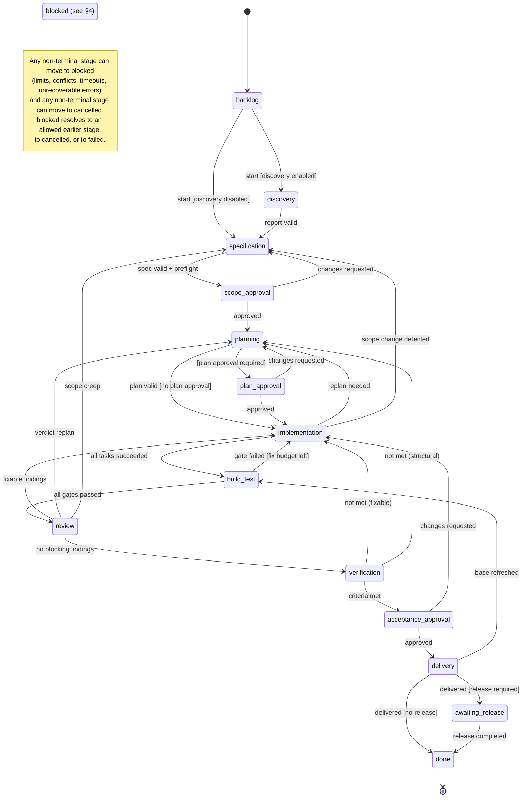
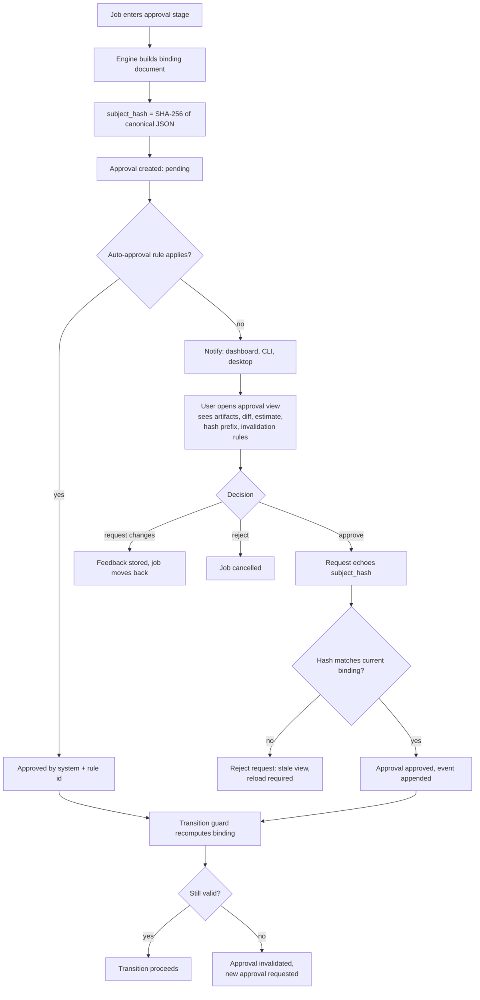
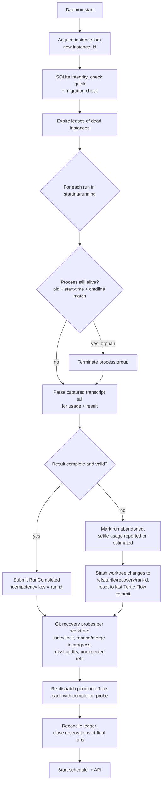

# Workflow — State Machine, Approvals, Gates, Retries and Recovery

| Field | Value |
|---|---|
| Document | WORKFLOW.md |
| Status | Proposed baseline; core decisions in [ADR-005](adr/ADR-005-workflow-state-machine.md), [ADR-006](adr/ADR-006-supervised-autonomy-approvals.md), [ADR-017](adr/ADR-017-recovery-idempotency-crash-safety.md) |
| Related | [DOMAIN-MODEL.md](DOMAIN-MODEL.md), [examples/example-workflow.yaml](examples/example-workflow.yaml) |

**Implementation status (2026-10-27).** The `strict` profile runs configured build, test and lint commands after each task, plus secret-scan and scope-conformance checks on that task's worktree diff. Failed task checks are sent to a fixer for at most the profile's configured fix iterations; exhaustion or missing required commands blocks the job. The integrated job still runs its full gate suite. Plan approval is required in `standard` when a plan has more than eight tasks or its frozen preflight token envelope exceeds the configured job token limit. The estimate is stored with its plan hash in a `PreflightReport`; scope and plan approval bindings include the configured job budget, and plan bindings include the preflight report. Changing the job limit therefore invalidates stale approvals. CLI and API decisions use the same approval service, which rechecks the current binding and invalidates stale decisions; duplicate requests reuse the pending row. A clean local base refresh invalidates acceptance and repeats gates, review and verification. For PR-delivery projects, a bounded fetch of `origin/<target>` runs before worktree creation and delivery (PR #35); a moved remote target follows the same refresh path. Standard retains its existing autonomous major-finding fix behavior; the table's tighter standard severity is not implemented. Local squash remains the default for all profiles; PR delivery is an explicit project setting.

---

## 1. Overview

A **job** moves through a fixed graph of **stages** defined in Rust. A **workflow profile** selects which optional stages are active, configures gates, approval requirements and limits, but cannot add states or arbitrary edges. The engine (`turtle-workflow::decide`) is a pure function evaluated inside the single writer transaction; side effects are emitted as idempotent **effects** ([ARCHITECTURE.md §3.2](ARCHITECTURE.md#32-the-command--transaction--effect-loop)).

Critical refinement of the requested lifecycle:

1. **Release is a separate aggregate.** The requested lifecycle placed *Release Planning → Release Approval → Release* inside each job. In practice releases bundle many jobs and have their own failure modes (rollback). Jobs end at **Delivery**; a job may optionally wait in `awaiting_release` until a Release containing it completes ([§8](#8-release-workflow)).
2. **Pause, budget wait and rate-limit wait are *holds*, not states.** Modeling them as states loses the position in the workflow and multiplies transitions. A hold is an overlay; the stage is preserved.
3. **"Build & Tests" exists at two levels.** Per-task gates run inside `implementation` (fast feedback); the job-level `build_test` stage runs the full gate suite on the integrated job HEAD.
4. **`blocked` is an explicit state** for situations requiring human decision (limits exhausted, conflicts, unrecoverable errors). It records where it came from and which resolutions are allowed.

## 2. Stage Semantics

| Stage | Purpose | Primary actor | Output artifact(s) |
|---|---|---|---|
| `backlog` | Job created, not started | — | — |
| `discovery` | Analyze repo & request; surface risks/questions | `discovery` role | `discovery_report` |
| `specification` | Define scope & acceptance criteria | `spec_writer` role (+ user edits) | `specification` rev N, `preflight_report` |
| `scope_approval` | Human approves scope, estimate, budget envelope | User | Approval |
| `planning` | Task DAG with expected paths & estimates | `planner` role | `plan` rev N |
| `plan_approval` | (strict only, or plan exceeding thresholds) | User | Approval |
| `implementation` | Execute tasks; per-task gates; fix loops | `implementer`, `fixer` | `patch`, `gate_result`, commits |
| `build_test` | Full gate suite on job HEAD | Gate runner (deterministic) | `gate_result` set |
| `review` | AI code review of full job diff | `reviewer` role | `review_report` |
| `verification` | Check each acceptance criterion | Deterministic checks + `verifier` role | `verification_report` |
| `acceptance_approval` | Human accepts exact diff | User | Approval |
| `delivery` | Merge / PR via controlled Git workflow | Turtle Flow Git subsystem | `delivery_record` |
| `awaiting_release` | Delivered; waiting for a release (optional) | — | — |
| `done` | Terminal success | — | `job_report` (optional) |
| `blocked` | Needs human resolution | User | — |
| `cancelled` | Terminal; user cancelled or rejected | — | — |
| `failed` | Terminal; unrecoverable and user confirmed | — | — |

## 3. Job States

<!-- diagram: 03-workflow-state-machine -->


`blocked`, `cancelled` and `failed` edges are omitted from the diagram for readability; they are fully specified in §4.

### 3.1 Holds (overlays)

| Hold | Set by | Effect | Cleared by |
|---|---|---|---|
| `paused{soft}` | User | No new runs/gates start; current run finishes | `resume` |
| `paused{hard}` | User | Current run/gate terminated (recorded `cancelled`), reservation released | `resume` (stage step restarts) |
| `awaiting_budget` | Engine (preflight/reservation failure on hard budget) | No new runs; budget-increase approval requested | Approval granted (budget raised) or user lowers scope |
| `rate_limited{provider, until}` | Run supervisor on rate-limit error | Runs needing that provider wait; scheduler may fail over if allowed | Time passes / probe succeeds |

Holds never change `state` and are recorded as events. A job may have multiple holds; it is runnable only with none.

## 4. Transitions and Guards

Guards are pure functions over `(JobAggregate, DecisionContext)`; `DecisionContext` contains precomputed facts (artifact validation results, approval validity, gate results for current tree hash, budget headroom, dependency status). Each guard has a stable name used in `TransitionRejected` errors and in tests.

| # | From → To | Trigger | Guards (all must hold) | Effects on entry |
|---|---|---|---|---|
| T01 | backlog → discovery | `StartJob` | `profile.discovery_enabled(complexity_hint)`, `project_active` | `StartRun(discovery)` |
| T02 | backlog → specification | `StartJob` | `!discovery_enabled`, `project_active` | `StartRun(spec_writer)` |
| T03 | discovery → specification | `RunCompleted(discovery)` | `artifact_schema_valid(discovery_report)` | `StartRun(spec_writer)` |
| T04 | specification → scope_approval | `RunCompleted(spec_writer)` or `SpecEdited` | `artifact_schema_valid(spec)`, `criteria_nonempty`, `preflight_computed` | `RequestApproval(scope)` (or auto-approve per §6.4) |
| T05 | scope_approval → planning | `ApprovalGranted(scope)` | `approval_valid(scope)`, `preflight_decision != deny` | `StartRun(planner)` |
| T06 | scope_approval → specification | `ApprovalChangesRequested` | — | `StartRun(spec_writer, feedback)` |
| T07 | scope_approval → cancelled | `ApprovalRejected` | — | `ReleaseReservations` |
| T08 | planning → plan_approval | `RunCompleted(planner)` | `plan_valid`, `plan_approval_required` (strict, or plan estimate > approved envelope × 1.0, or tasks > `max_tasks_without_approval`) | `RequestApproval(plan)` |
| T09 | planning → implementation | `RunCompleted(planner)` | `plan_valid`, `!plan_approval_required`, `dependencies_delivered`, `plan_within_scope` | `CreateWorktree` (idempotent), mark ready tasks |
| T10 | plan_approval → implementation | `ApprovalGranted(plan)` | `approval_valid(plan)`, `dependencies_delivered` | as T09 |
| T11 | plan_approval → planning | `ApprovalChangesRequested` | `loop_limit_ok(planning)` | `StartRun(planner, feedback)` |
| T12 | implementation → build_test | `TaskSucceeded` (last) | `all_tasks_terminal_ok` | `RunGates(job_suite)` |
| T13 | implementation → planning | `TaskFailed` (fix limit) | `replan_allowed`, `loop_limit_ok(planning)` | `StartRun(planner, failure_context)` |
| T14 | implementation → specification | `ScopeChangeDetected` | — | `InvalidateApproval(scope)`, `StartRun(spec_writer, delta)` |
| T15 | build_test → review | `GatesFinished` | `all_required_gates_passed(head_tree)` | `StartRun(reviewer)` |
| T16 | build_test → implementation | `GatesFinished` | `some_gate_failed`, `fix_iterations_left` | create fix task, `StartRun(fixer)` |
| T17 | review → verification | `RunCompleted(reviewer)` | `no_findings_above(auto_fix_max_severity)` ∧ `no_blockers` | `RunVerification` |
| T18 | review → implementation | `RunCompleted(reviewer)` | `fixable_findings`, `fix_iterations_left` | fix task(s), `StartRun(fixer)` |
| T19 | review → planning | `RunCompleted(reviewer)` | `verdict == replan`, `loop_limit_ok(planning)` | `StartRun(planner, review)` |
| T20 | review → specification | `RunCompleted(reviewer)` | `finding.category == scope_creep` beyond tolerance | invalidate scope approval |
| T21 | verification → acceptance_approval | `VerificationCompleted` | `all_criteria(met ∨ acknowledged_unverifiable)` | `RequestApproval(acceptance)` |
| T22 | verification → implementation | `VerificationCompleted` | `not_met_fixable`, `fix_iterations_left` | fix task |
| T23 | verification → planning | `VerificationCompleted` | `not_met_structural`, `loop_limit_ok(planning)` | planner run |
| T24 | acceptance_approval → delivery | `ApprovalGranted(acceptance)` | `approval_valid(acceptance)` (binding recomputed from worktree), `no_protected_path_unacknowledged` | `ProbeConflicts`, then `Deliver` |
| T25 | acceptance_approval → implementation | `ApprovalChangesRequested` | — | fix task with user feedback |
| T26 | acceptance_approval → cancelled | `ApprovalRejected` | — | cleanup per policy |
| T27 | delivery → done | `Delivered` | `!release_required` | `CleanupWorktree` |
| T28 | delivery → awaiting_release | `Delivered` | `release_required` | `CleanupWorktree` |
| T29 | delivery → build_test | `BaseRefreshed` | refresh succeeded without conflict | invalidate acceptance; `RunGates` |
| T30 | awaiting_release → done | `ReleaseCompleted` | — | — |
| T31 | *non-terminal* → blocked | `LimitReached`, `Timeout`, `ConflictDetected`, `UnrecoverableError` | — | release reservations; notify |
| T32 | blocked → *allowed target* | `ResolveBlock{target}` (user) | `target ∈ blocked.allowed_targets` | per target stage |
| T33 | *non-terminal* → cancelled | `CancelJob` (user) | — | terminate runs, release reservations, cleanup per flags |
| T34 | blocked → failed | `MarkFailed` (user) or block timeout (default 14 days) | — | cleanup per policy |

**Loop limits (defaults, profile-configurable):** `max_back_transitions_per_job = 6`; per-stage: `planning ≤ 3`, `specification ≤ 3`; `max_fix_iterations` per task and per job-level gate/review/verification loop (fast 2, standard 3, strict 3). Exceeding a limit → T31 with `allowed_targets` computed from the failed stage.

### 4.1 Guard implementation sketch

```rust
pub fn decide(job: &JobAggregate, cmd: &JobCommand, cx: &DecisionContext)
    -> Result<Decision, TransitionRejected>
{
    use JobState::*;
    if job.state.is_terminal() { return Err(reject("job_terminal")); }
    match (&job.state, cmd) {
        (ScopeApproval, JobCommand::ApprovalGranted { approval_id }) => {
            guard(cx.approval_valid(*approval_id, GateKind::Scope), "approval_valid")?;
            guard(cx.preflight_decision != PreflightDecision::Deny, "preflight_not_denied")?;
            Ok(job.transition(Planning)
                .emit(DomainEvent::StageEntered { stage: Planning })
                .effect(EffectKind::StartRun { role: Role::Planner, task: None }))
        }
        (BuildTest, JobCommand::GatesFinished { tree_hash, results }) => {
            guard(*tree_hash == cx.current_tree_hash, "results_match_tree")?;
            if results.all_required_passed(&job.profile) {
                Ok(job.transition(Review).effect(EffectKind::StartRun { role: Role::Reviewer, task: None }))
            } else if job.fix_iterations_left(Stage::BuildTest) {
                Ok(job.transition(Implementation).with_fix_task(results.failures()))
            } else {
                Ok(job.block(BlockReason::FixLimitReached, allowed_targets(Stage::BuildTest)))
            }
        }
        // ... every (state, command) pair handled explicitly; default arm rejects
        _ => Err(reject("no_transition_for_command")),
    }
}
```

A table-driven test enumerates every `(JobState, JobCommand)` pair and asserts the expected outcome (accept → target, or specific guard rejection). This makes the state machine reviewable and prevents accidental edges.

### 4.2 Implementation notes (`turtle-workflow`)

These rules were made precise while implementing `decide()`. The code and the snapshot `crates/turtle-workflow/tests/snapshots/` are authoritative.

- **Who may issue commands.**
  - Agents can never issue commands (`agents_cannot_issue_commands`).
  - Results of runs and gates are machine-only (`machine_result_only`). A user cannot report "tests passed".
  - Approval decisions, cancel, pause/resume, block resolution and mark-failed are user-only.
  - `ApprovalGranted` from the system is accepted only for the scope gate under the `fast` auto-scope rule.
- **Loop budgets.**
  - Only *autonomous* backward transitions consume budgets: fix loops, replans, respecs and back transitions.
  - Human "request changes" and block resolution never consume them.
  - A replan or respec resets the fix-iteration counter, because the new plan gets a fresh fix budget.
- **Block resolution never bypasses approvals.** `ResolveBlock` into `delivery` requires a valid acceptance approval, and into `planning` a valid scope approval (J-4, J-5).
- **Holds do not stop transitions.** A result arriving while a job is paused is still recorded. The scheduler simply dispatches no new effects for jobs with holds.
- **Waiting for dependencies is a hold.** A plan that is ready while dependencies are undelivered sets `WaitingForDependencies` and keeps the stage. `DependenciesDelivered` then enters `implementation`.
- **Dependency wait invariant.** `ready_for_implementation` is true exactly while the `WaitingForDependencies` hold is set. Any stage change, a new plan, or a human sending the plan back ends the wait. An earlier version could strand the hold after "request changes" on an approved plan; a property invariant and a regression test now cover it.
- **Events rebuild state.** Cancelling emits a `HoldRemoved` event per hold, so job stage, holds and block info can be rebuilt from the event log alone (tested in `turtle-store`).
- **Testing.** The property test starts sequences in random non-terminal states and down-weights destructive commands. Walks that start at `backlog` almost never reach `delivery`, which would leave J-5 effectively untested. A mutation check (removing the acceptance guard) fails the test immediately.

## 5. Workflow Profiles

Profiles are TOML/YAML documents with a `base` of `fast`, `standard`, or `strict`. The engine snapshots the resolved profile into the job at creation (hash stored). Full example: [examples/example-workflow.yaml](examples/example-workflow.yaml).

| Setting | fast | standard | strict |
|---|---|---|---|
| `stages.discovery` | off | auto (complexity ≥ M) | on |
| `stages.plan_approval` | off | threshold-based | on |
| `approvals.scope` | auto if complexity ≤ S ∧ preflight allow | required | required |
| `approvals.acceptance` | required | required | required |
| `gates.per_task` | build, test | build, test | build, test, lint |
| `gates.job` | build, test | build, test, lint | build, test, lint, format_check, custom |
| `gates.static` | secret_scan, protected_paths | + diff_size | + dependency_changes |
| `review.required` | blockers-only review | full | full |
| `review.cross_provider` | no | preferred | required |
| `auto_fix_max_severity` | major | minor | nit |
| `max_fix_iterations` | 2 | 3 | 3 |
| `diff_size_limit` (changed lines) | 400 | 1500 | 1500 |
| `delivery.mode` | local squash \| pr | local squash \| pr | local squash \| pr |
| `timeouts.job` | 2 h | 8 h | 24 h |
| `timeouts.run_default` | 20 min | 30 min | 45 min |

**Escalation:** path rules (`src/auth/** → strict`), job type (`security`), or preflight risk score can escalate a profile. Escalation after scope approval invalidates the scope approval (the user approved under different rules).

**Validation rules for custom profiles:** cannot disable `acceptance` approval for delivery to protected branches; cannot set `max_fix_iterations > 10`; cannot disable `secret_scan` and `protected_paths` gates; cannot enable `auto_accept` unless `delivery.target` is a non-protected branch; must reference only known gates and roles.

## 6. Approvals

### 6.1 Approval gates

| Gate kind | When | Required by default |
|---|---|---|
| `scope` | Entering `scope_approval` | standard, strict (fast: auto under conditions) |
| `plan` | Entering `plan_approval` | strict; standard when thresholds exceeded |
| `budget_increase` | Hold `awaiting_budget` | Always when hard budget would be exceeded |
| `scope_change` | Scope change detected mid-job | Always (re-approval of revised spec) |
| `policy_exception` | Profile/policy relaxation requested (e.g. allow dependency change in strict, run without provider sandbox) | Always |
| `acceptance` | Entering `acceptance_approval` | Always |
| `release` | Release execution | Always (FR-156) |

### 6.2 Approval binding

An approval binds to a **binding document** whose canonical JSON (RFC 8785) is hashed into `subject_hash`.

```json
{
  "schema": "turtle.approval-binding.v1",
  "gate_kind": "acceptance",
  "job_id": "01JB7Y0Q4N3T9Z8K2M6W5R1C7D",
  "profile_hash": "sha256:7c1e…",
  "policy_version": 4,
  "artifacts": {
    "specification": "sha256:91af…@rev3",
    "plan": "sha256:0b2d…@rev2",
    "verification_report": "sha256:c4e0…@rev1",
    "review_report": "sha256:e19a…@rev2"
  },
  "git": {
    "base_commit": "3f2a9c1…",
    "head_commit": "a81d77e…",
    "diff_sha256": "sha256:5d0c…",
    "target_branch": "main"
  },
  "budget_envelope": { "tokens_max": 1200000, "cost_max_usd": null },
  "acknowledged_flags": ["protected_path:.github/workflows/ci.yml"]
}
```

`diff_sha256` is the SHA-256 of `git diff --binary --full-index <base>..<head>` output (normalized). Including both commits and the diff hash makes the binding robust against history rewriting.

### 6.3 Invalidation rules

| Change | Invalidates |
|---|---|
| New spec revision (agent or user) | scope, plan, acceptance |
| New plan revision | plan, acceptance |
| Any new commit in worktree / working-tree change after approval | acceptance |
| Base branch refresh (rebase/merge) | acceptance |
| Profile escalation | scope (and plan if approved) |
| Policy version change affecting job (e.g. new protected path) | acceptance (re-evaluation) |
| Actual + projected usage exceeds approved `budget_envelope` | scope (converted to `budget_increase` request; scope itself not re-reviewed unless user chooses) |
| Approval expiry reached | that approval |

Invalidation is evaluated (a) eagerly when the change happens (engine emits `ApprovalInvalidated`) and (b) defensively at every guard that requires the approval (recompute binding hash and compare). (b) protects against missed eager invalidation.

### 6.4 Auto-approval

Only `scope` approval can be auto-granted, only in `fast`, and only if: complexity ≤ S, preflight decision `allow`, estimate P90 ≤ `fast.auto_scope_max_tokens`, no protected paths in discovery/spec affected areas. Auto-approvals are recorded as `decided_by = system` with the rule ID — visible and auditable. Acceptance can never be auto-approved for delivery to protected branches.

### 6.5 Approval process

<!-- diagram: 10-approval-process -->


### 6.6 Approval channels and bypass prevention

- Allowed channels: authenticated dashboard session; CLI `turtle approve` running on an interactive TTY (refuses when stdin is not a TTY unless `--non-interactive` *and* the turtle config enables scripted approvals, recorded as channel `cli_script`).
- The decision endpoint requires the `subject_hash`; the server refuses approval requests from runs' process trees where detectable (peer credential PID ancestry check on the Unix socket — best-effort; see [SECURITY.md §6.5](SECURITY.md#65-approval-bypass-prevention)).

## 7. Quality Gates

| Gate | Kind | Runs in | Passes when |
|---|---|---|---|
| `build` | deterministic command | per task / job | exit 0 within timeout |
| `test` | deterministic command (+ parser for JUnit XML/TAP/cargo/jest/pytest summaries) | per task / job | exit 0; parsed failures = 0 when parser available |
| `lint`, `format_check` | deterministic command | job (strict: per task) | exit 0 |
| `custom:<name>` | deterministic command | job | exit 0 |
| `secret_scan` | built-in scanner on diff | per task + job | no new secrets |
| `protected_paths` | policy on diff | job | no protected path changes, or flagged for acknowledgement |
| `diff_size` | policy on diff | job | changed lines ≤ limit (else `blocked` → user decides split or accept) |
| `dependency_changes` | manifest/lockfile diff analysis | job (strict) | no new deps, or acknowledged |
| `review_blockers` | AI review findings | review stage | zero `blocker` findings |
| `criteria_verification` | verification report | verification stage | all criteria met/acknowledged |
| `scope_conformance` | changed paths vs. spec `affected_areas` + plan `expected_paths` | per task + job | out-of-scope changed lines ≤ tolerance (default 10% and ≤ 50 lines) |

Gates run via `turtle-exec` with timeouts and output caps; results bind to the exact tree hash (G-1). Flaky test handling: optional `retry_on_fail = 1` for the `test` gate, with flake recorded when a retry passes (shown in analytics).

## 8. Release Workflow

Releases are a separate aggregate (Could for MVP; designed now so jobs can reference them).

```text
draft → planning → release_approval → releasing → released
                         │                 │
                         └─ changes ───────┘ failed → rollback_pending → rolled_back | blocked
```

| State | Description |
|---|---|
| `draft` | User selects delivered jobs / target commit |
| `planning` | `release_notes` role drafts notes; deterministic checks (all jobs delivered, target contains their commits, version unused) |
| `release_approval` | Approval bound to `release_plan` hash + target commit; **cannot be auto-approved** |
| `releasing` | Create annotated tag; (post-MVP) run deploy hooks with timeouts |
| `released` | Jobs in `awaiting_release` → `done` |
| `failed` / `rollback_pending` / `rolled_back` | Post-MVP: run rollback hooks; tags are never deleted automatically |

## 9. Retry, Failure, Pause, Cancel

### 9.1 Retry policies

| Error class | Examples | Retry | Backoff |
|---|---|---|---|
| `transient_provider` | network error, 5xx-equivalent, CLI crash with known transient signature | up to 3 | exponential 10 s → 2 min, jitter |
| `rate_limited` | provider rate-limit message/exit code | unlimited within job timeout | provider hint, else 1 → 15 min; sets `rate_limited` hold |
| `schema_violation` | invalid structured output | 1 repair attempt in same session (if resumable) else new run | none |
| `timeout` | run exceeded wall-clock | 1 (with higher limit if budget allows) | none |
| `auth` | not logged in / expired | none → `blocked` with remediation | — |
| `budget` | reservation impossible | none → `awaiting_budget` hold | — |
| `policy_violation` | agent committed, wrote outside worktree | none → `blocked` + security event | — |
| `gate_failure` | tests failed | handled by fix loop, not retry | — |
| `internal` | Turtle Flow bug | none → `blocked`, bug report bundle | — |

Retries create a new `AgentRun` (attempt + 1) with a new reservation; the failed run is settled with its actual usage (FR-086: failed attempts count toward cost per verified job).

### 9.2 Failure handling

- Every failure records `error.code`, `retryable`, and the stage step. Jobs only reach `failed` by explicit user decision or block timeout — the system prefers `blocked` with options to silent failure.
- `blocked.allowed_targets` examples: from `build_test` fix limit → {`implementation` (with fresh fix budget), `planning`, `cancelled`, `failed`}.

### 9.3 Pause/resume

- Soft pause: scheduler stops dispatching; the running step completes and commits its result; the job holds.
- Hard pause: running process group gets SIGTERM, then SIGKILL after 5 s; run → `cancelled`; working-tree changes from the interrupted run are **stashed into a recovery ref** (`refs/turtle/recovery/<run-id>`) and the tree is reset to the last Turtle Flow commit, so resumption starts clean.
- Resume: clears hold; the scheduler re-evaluates the current stage's next step (idempotent).

### 9.4 Cancellation

1. Engine sets `cancelled` (terminal) and emits effects: terminate runs, release reservations, mark pending approvals `superseded`.
2. Worktree: removed (default) or kept (`--keep-worktree`).
3. Branch: kept 14 days by default for forensics (`--delete-branch` to remove immediately).
4. Artifacts and events are always kept.

## 10. Recovery Behavior

Recovery runs at daemon start before the scheduler, and also per-job when a lease expires ([ADR-017](adr/ADR-017-recovery-idempotency-crash-safety.md)).

<!-- diagram: 11-crash-recovery -->


### 10.1 Step boundaries and recovery actions (crash-injection catalogue)

These 25 boundaries are each covered by a crash-injection test ([TESTING-STRATEGY.md §6](TESTING-STRATEGY.md#6-crash-injection-and-recovery-tests-tst-12)).

| # | Crash point | Detected by | Recovery action |
|---|---|---|---|
| 1 | Job created; first effect not dispatched | pending effect in outbox | Re-dispatch |
| 2 | Preflight computed; reservation not written | run `queued` without reservation | Re-run preflight (deterministic) |
| 3 | Reservation written; process not spawned | run `starting`, no PID | Spawn (idempotency key = run id) |
| 4 | Process spawned; PID not recorded | run `starting`, scratch dir has `pid` file written by supervisor before exec | Probe PID file; kill orphan; restart run as attempt+1 |
| 5 | Run streaming | run `running`, lease expired | Orphan check → kill; parse transcript tail |
| 6 | Process exited; result not committed | transcript has final result event | Submit `RunCompleted` from transcript |
| 7 | Output blob written; revision not committed | orphan blob (no row) | Recreated from transcript in step 6; orphan blobs GC'd |
| 8 | Run committed; settlement missing | final run with open reservation | Ledger reconciliation settles |
| 9 | Approval pending | — | Nothing (waits for user) |
| 10 | Approval decided; effects pending | outbox | Re-dispatch |
| 11 | Worktree intent written; `git worktree add` not run | effect pending; dir absent | Run `git worktree add` |
| 12 | `git worktree add` done; DB not updated | dir exists, HEAD = expected base, branch matches | Mark effect complete |
| 13 | Branch created; worktree add failed | branch exists, no worktree | `git worktree add <path> <branch>` (reuse branch if at base) |
| 14 | Agent modified files; crashed before commit | dirty tree, run not final | Stash to recovery ref; reset; retry task |
| 15 | `git commit` in progress | `index.lock` present, no git process | Remove stale lock (only in Turtle Flow worktree, only if no git process holds it); recompute |
| 16 | Commit created; DB not updated | HEAD has trailer `Turtle-Run: <id>` | Record commit (probe by trailer) |
| 17 | Gate running | gate `running`, lease expired | Kill orphan; re-run gate (gates are idempotent by design) |
| 18 | Gate finished; result not committed | output file with exit code in scratch | Re-run gate (cheaper and safer than trusting partial file) |
| 19 | Fix task created; not dispatched | outbox | Re-dispatch |
| 20 | Merge probe running | effect pending | Re-run (non-mutating) |
| 21 | Delivery merge started; ref not updated | target ref unchanged, temp merge worktree present | Remove temp worktree; retry delivery |
| 22 | Target ref updated; DB not updated | target branch contains `head_commit` (or squash commit with `Turtle-Job` trailer) | Mark delivered |
| 23 | Pushed; PR not created | remote branch exists, no PR record | `gh pr list --head <branch>` → create if absent |
| 24 | PR created; DB not updated | `gh pr list --head <branch>` returns PR | Record PR |
| 25 | Worktree cleanup partial | dir missing or present with job terminal | `git worktree remove --force` / `git worktree prune`; mark cleaned |

### 10.2 Crash-injection coverage (status)

The effect-specific probes are covered by the end-to-end crash test with real Git (see ADR-017, "Executor probes"): worktree creation, task commits, delivery, approval requests and artifact reuse. The generic effect protocol (claim, execute, complete-with-command, requeue after restart) is covered at every step boundary by `crates/turtle-scheduler/tests/crash.rs`. That covers the *shape* of boundaries 1, 3, 6, 10, 19 and the "effect pending, then dispatched" parts of 11, 14–25 in the table above. Boundaries 2, 4, 5, 7 and 8 (agent runs, reservations, ledger) still need corresponding executor tests. Coverage for Git-specific probes of 11–16 and 20–25 is partial: see the real-Git cases above and PR #35's remote-base fetch fixture; this does not yet exercise every listed crash boundary.

## 11. Job Dependencies and Parallel Execution

- **Dependencies:** `blocked_by` edges between jobs of one project; cycles rejected at creation. A dependent job may run discovery/spec/planning but waits before `implementation` until dependencies are `done` or `awaiting_release`; its base commit is then taken from the updated target branch.
- **Within a job:** tasks execute sequentially (MVP). Rationale: one worktree, shared build state; parallel tasks need separate worktrees and a merge step — designed as *Future* (sub-worktrees per task branch merged into the job branch).
- **Across jobs:** parallel, subject to limits ([ADR-011](adr/ADR-011-job-scheduling-concurrency.md)):
  - global `max_concurrent_runs` (default 3), per-provider `max_concurrent_runs` (default 2), per-project `max_concurrent_jobs` (default 2), gates `max_concurrent_gates` (default = CPU cores / 2).
  - **Conflict prediction:** before a job enters `implementation`, its plan's `expected_paths` are intersected with other active jobs' expected/changed paths. Overlap → policy: `warn` (default), `serialize` (wait), or `allow`.
  - **Conflict detection:** periodic `merge-tree` probes against the target branch and pairwise between active job branches (cheap, non-mutating).
- **Scheduling order:** priority, then dependency readiness, then age; approvals waiting never consume run slots.
